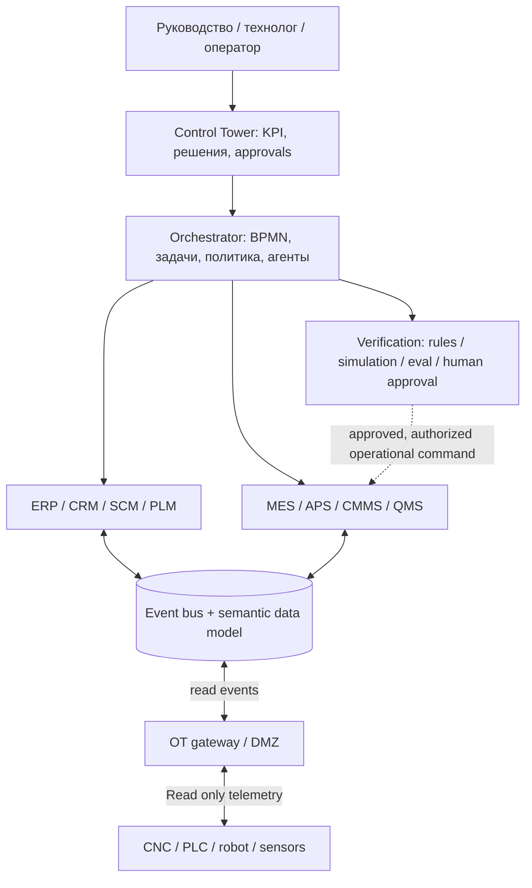

# Industrial AI Workflow Atlas — 130 алгоритмов и систем для производства, ЧПУ и менеджмента
**Дата исследования:** 17 ноября 2026. **Версия:** 1.0. **Автор:** исследовательский аналитический синтез с проверенными первоисточниками.

> **Статус доказательств.** Этот документ содержит **130 уникальных инженерных blueprints**, декомпозированных для проектирования. Это **не** перечень 130 коммерческих внедрений и не обещание ROI. Источники ниже удостоверяют стандарты, архитектуры, алгоритмы и ограниченное число конкретных кейсов. Для каждого workflow необходимы обследование предприятия, техническое ТЗ и проверка пригодности.

## 0. Как читать и применять каталог
**Слои:** ISA-95 L0–L4, поверх них проектная аналитическая надстройка, а не новый стандартный L5. **Разделение ответственности:** вероятностный AI предлагает/объясняет; решатель оптимизирует; проверяемые правила и штатные контроллеры исполняют; сотрудник утверждает критичные действия.
**Паспорт каждой записи:** триггер и данные → этапы → алгоритмический механизм → интеграционный контур → KPI → обязательная проверка. Статус каждого паспорта — проектная композиция, если не указано иное в разделе подтверждённых кейсов.

### Уровни подтверждения
- **C (case):** опубликовано именованное внедрение, но результаты обычно заявлены поставщиком.
- **R (reference):** официально документированная архитектура/алгоритм с конкретными шагами.
- **D (design):** составной проектный workflow, построенный на описанных методах; отдельного доказательства внедрения именно этой комбинации нет.
Все 130 записей помечены **D**; конкретные C и R вынесены отдельно, чтобы избежать ложных подтверждений.

### Архитектура референсной платформы

**Важно:** стрелка между gateway и OT означает телеметрию; не следует считать её разрешением отправлять управляющие команды. Все изменения производственных программ и действий роботов проходят через независимые штатные интерфейсы, промышленную безопасность и необходимые подтверждения.

### Минимальный канонический контракт события
```json
{
  "event_id": "uuid", "event_type": "machine.state.changed",
  "occurred_at_utc": "2026-11-17T01:00:00Z", "ingested_at_utc": "...",
  "site_id": "plant-01", "asset_id": "cnc-014",
  "work_order_id": "WO-2026-0042", "operation_id": "OP-020",
  "source_system": "mtconnect-adapter", "source_sequence": 12345,
  "value": {"execution": "ACTIVE"}, "unit": null,
  "quality": "valid", "schema_version": "1.0", "provenance": "..."
}
```
Строго обязательны схема версий, UTC с часовыми поясами, ключи связности с ERP/MES, дедупликация событий, события late arrival, provenance, event ownership.

## 1. Полный каталог — 130 workflow

### A. Подключение оборудования и цифровая основа (10 решений)
**Эталонная цепочка:** CNC/PLC/SCADA → Industrial Edge → event bus → historian/MES → dashboards. **Механизмы:** OT/edge engineering. **Основания:** [MT](#mt), [OPC](#opc), [UNS](#uns), [ISA95](#isa95), [OT](#ot).

#### A-01. Паспорт станочного парка — D
- **Событие/данные:** Инвентаризация CNC, PLC, контроллеров, прошивок.
- **Исполняемый процесс:** Сканирование конфигурации → канонизация моделей → каталог активов.
- **Алгоритмы:** Entity resolution; schema mapping.
- **Интеграционный контур:** CNC/PLC/SCADA → Industrial Edge → event bus → historian/MES → dashboards.
- **Измеряемый результат:** Доля станков с проверенным паспортом.
- **Гейт, владелец, безопасность:** Изменения конфигурации подтверждает OT-инженер.

#### A-02. Нормализация статусов станков — D
- **Событие/данные:** Execution, mode, program, alarm, spindle.
- **Исполняемый процесс:** Адаптеры → нормализация → состояние по стандартной онтологии.
- **Алгоритмы:** Finite-state machine; mapping rules.
- **Интеграционный контур:** CNC/PLC/SCADA → Industrial Edge → event bus → historian/MES → dashboards.
- **Измеряемый результат:** Полнота и задержка состояний.
- **Гейт, владелец, безопасность:** Не писать команды в контроллер.

#### A-03. Унифицированный поток событий — D
- **Событие/данные:** Операции CNC, PLC, MES, ERP.
- **Исполняемый процесс:** CDC/OPC → нормализованные события → топики UNS → подписчики.
- **Алгоритмы:** Event sourcing; idempotent ingestion.
- **Интеграционный контур:** CNC/PLC/SCADA → Industrial Edge → event bus → historian/MES → dashboards.
- **Измеряемый результат:** Доля потерянных и дублированных событий.
- **Гейт, владелец, безопасность:** Сверка последовательности и времени.

#### A-04. Автоматическая классификация простоев — D
- **Событие/данные:** Сигналы станков, смены, комментарии.
- **Исполняемый процесс:** Сегментация интервалов → код причины → запрос оператору.
- **Алгоритмы:** Rules + classifier + active learning.
- **Интеграционный контур:** CNC/PLC/SCADA → Industrial Edge → event bus → historian/MES → dashboards.
- **Измеряемый результат:** Необъяснённые минуты простоя.
- **Гейт, владелец, безопасность:** Оператор подтверждает причину.

#### A-05. Контекстуализация машинных данных — D
- **Событие/данные:** Теги, машино-часы, ID операции, заказа.
- **Исполняемый процесс:** Обогащение по справочникам → join событий → контекстная запись.
- **Алгоритмы:** Temporal joins; knowledge graph.
- **Интеграционный контур:** CNC/PLC/SCADA → Industrial Edge → event bus → historian/MES → dashboards.
- **Измеряемый результат:** Доля событий с корректным заказом.
- **Гейт, владелец, безопасность:** Контроль рассинхронизации часов.

#### A-06. Трассировка партии по операциям — D
- **Событие/данные:** Серийный номер, станок, программа, партия инструмента.
- **Исполняемый процесс:** Сканирование → связка событий → цифровой маршрут.
- **Алгоритмы:** Graph lineage; temporal joins.
- **Интеграционный контур:** CNC/PLC/SCADA → Industrial Edge → event bus → historian/MES → dashboards.
- **Измеряемый результат:** Полнота прослеживаемости.
- **Гейт, владелец, безопасность:** Блокировка ручного изменения истории.

#### A-07. Система сигналов качества данных OT — D
- **Событие/данные:** Потоки датчиков и historian.
- **Исполняемый процесс:** Профиль сигнала → пропуски/аномалии → тикет на источник.
- **Алгоритмы:** Drift/anomaly detection; validation.
- **Интеграционный контур:** CNC/PLC/SCADA → Industrial Edge → event bus → historian/MES → dashboards.
- **Измеряемый результат:** Data freshness; missing-rate.
- **Гейт, владелец, безопасность:** Проверка инженером до использования модели.

#### A-08. Каталог тегов и инженерный словарь — D
- **Событие/данные:** Названия тегов PLC, описания, спецификации.
- **Исполняемый процесс:** Извлечение → семантическое сопоставление → одобренный глоссарий.
- **Алгоритмы:** Embeddings; schema matching; RAG.
- **Интеграционный контур:** CNC/PLC/SCADA → Industrial Edge → event bus → historian/MES → dashboards.
- **Измеряемый результат:** Покрытие тегов словарём.
- **Гейт, владелец, безопасность:** Изменения семантики согласуются.

#### A-09. Двусторонняя синхронизация задания MES–CNC — D
- **Событие/данные:** ERP заказы, MES задания, NC-файлы.
- **Исполняемый процесс:** Проверка версии задания → одобрение → передача через штатный интерфейс → подтверждение.
- **Алгоритмы:** State machine; signatures; checksum.
- **Интеграционный контур:** CNC/PLC/SCADA → Industrial Edge → event bus → historian/MES → dashboards.
- **Измеряемый результат:** Ошибки передачи заданий.
- **Гейт, владелец, безопасность:** Доступ на запись только через сертифицированный контур.

#### A-10. Edge аналитика без облака — D
- **Событие/данные:** Высокочастотные сигналы, локальные камеры.
- **Исполняемый процесс:** Локальный сбор → inference → события в MES → периодическая синхронизация.
- **Алгоритмы:** Edge inference; buffering; fallback.
- **Интеграционный контур:** CNC/PLC/SCADA → Industrial Edge → event bus → historian/MES → dashboards.
- **Измеряемый результат:** Задержка inference и доступность.
- **Гейт, владелец, безопасность:** Никакой зависимости защитных функций от AI.

### B. CAD/CAM, технологическая подготовка и ЧПУ (10 решений)
**Эталонная цепочка:** CAD/PLM → техпроцесс → CAM → симуляция/постпроцессор → CNC. **Механизмы:** CAM/CNC engineering. **Основания:** [CAM](#cam), [CLOUDNC](#cloudnc), [OPC](#opc), [ISA95](#isa95), [NIST](#nist).

#### B-01. RFQ to manufacturability — D
- **Событие/данные:** STEP, чертёж, допуски, материал, количество.
- **Исполняемый процесс:** Парсинг → выделение признаков → DFM-флаги → заключение технолога.
- **Алгоритмы:** CAD feature recognition; rule engine.
- **Интеграционный контур:** CAD/PLM → техпроцесс → CAM → симуляция/постпроцессор → CNC.
- **Измеряемый результат:** Время и точность DFM-анализа.
- **Гейт, владелец, безопасность:** Технолог утверждает заключение.

#### B-02. AI-assisted feature recognition — D
- **Событие/данные:** CAD B-rep, поверхности, отверстия.
- **Исполняемый процесс:** Топология → геометрические признаки → типовые операции.
- **Алгоритмы:** Geometric algorithms; supervised ML.
- **Интеграционный контур:** CAD/PLM → техпроцесс → CAM → симуляция/постпроцессор → CNC.
- **Измеряемый результат:** Recall признаков.
- **Гейт, владелец, безопасность:** Проверка сложных признаков.

#### B-03. Генерация чернового техпроцесса — D
- **Событие/данные:** Модель, материал, станочный парк, допуски.
- **Исполняемый процесс:** Выбор баз → последовательность операций → маршрут → ревью.
- **Алгоритмы:** Planning rules; retrieval; constraint satisfaction.
- **Интеграционный контур:** CAD/PLM → техпроцесс → CAM → симуляция/постпроцессор → CNC.
- **Измеряемый результат:** Время подготовки маршрута.
- **Гейт, владелец, безопасность:** Без автоматического запуска программы.

#### B-04. Автоматический выбор инструмента — D
- **Событие/данные:** Геометрия, каталог инструмента, материал.
- **Исполняемый процесс:** Подбор кандидатов → фильтр совместимости → ранжирование.
- **Алгоритмы:** Rule filters; multiobjective optimization.
- **Интеграционный контур:** CAD/PLM → техпроцесс → CAM → симуляция/постпроцессор → CNC.
- **Измеряемый результат:** Доля корректных рекомендаций.
- **Гейт, владелец, безопасность:** Проверка технологом инструментальной оснастки.

#### B-05. AI-помощник CAM-стратегий — D
- **Событие/данные:** CAD, инструмент, станок, зажим.
- **Исполняемый процесс:** Генерация стратегий → проверка коллизий → CAM-проект.
- **Алгоритмы:** Feature-based CAM; search optimization.
- **Интеграционный контур:** CAD/PLM → техпроцесс → CAM → симуляция/постпроцессор → CNC.
- **Измеряемый результат:** Время программирования.
- **Гейт, владелец, безопасность:** Проверка симуляцией и специалистом.

#### B-06. Распознавание GD&T из чертежей — D
- **Событие/данные:** PDF/DXF, выноски, символы допуска.
- **Исполняемый процесс:** OCR/vision → структурирование GD&T → связь с моделями.
- **Алгоритмы:** Document AI; ontology rules.
- **Интеграционный контур:** CAD/PLM → техпроцесс → CAM → симуляция/постпроцессор → CNC.
- **Измеряемый результат:** Точность извлечения критических размеров.
- **Гейт, владелец, безопасность:** Подтверждение при неоднозначности.

#### B-07. Рекомендация режима резания — D
- **Событие/данные:** Инструмент, материал, глубина, мощность.
- **Исполняемый процесс:** Справочники → расчёт кандидатов → проверка ограничений.
- **Алгоритмы:** Physics equations; Bayesian optimization offline.
- **Интеграционный контур:** CAD/PLM → техпроцесс → CAM → симуляция/постпроцессор → CNC.
- **Измеряемый результат:** MTL, стойкость, поверхность.
- **Гейт, владелец, безопасность:** Процессная валидация на контрольной детали.

#### B-08. Оптимизация повторного использования УП — D
- **Событие/данные:** Архив NC, CAD, история исполнений.
- **Исполняемый процесс:** Поиск аналогов → сравнение версий → безопасное переиспользование.
- **Алгоритмы:** Embedding retrieval; diff; version control.
- **Интеграционный контур:** CAD/PLM → техпроцесс → CAM → симуляция/постпроцессор → CNC.
- **Измеряемый результат:** Повторное использование УП.
- **Гейт, владелец, безопасность:** Проверка ревизии и оснастки.

#### B-09. Проверка постпроцессора и NC-программы — D
- **Событие/данные:** CAM toolpath, кинематика, NC-код.
- **Исполняемый процесс:** Постпроцессинг → синтаксис → симуляция → выпуск версии.
- **Алгоритмы:** Static validation; kinematic simulation.
- **Интеграционный контур:** CAD/PLM → техпроцесс → CAM → симуляция/постпроцессор → CNC.
- **Измеряемый результат:** Ошибки УП до станка.
- **Гейт, владелец, безопасность:** Dry-run и утверждение программы.

#### B-10. Генерация маршрутных инструкций — D
- **Событие/данные:** Техпроцесс, оснастка, операции, риски.
- **Исполняемый процесс:** Структурирование → инструкции с изображениями → ревью → MES.
- **Алгоритмы:** RAG; templating; constraint checks.
- **Интеграционный контур:** CAD/PLM → техпроцесс → CAM → симуляция/постпроцессор → CNC.
- **Измеряемый результат:** Время обучения и ошибок настройки.
- **Гейт, владелец, безопасность:** Инженер утверждает все критические шаги.

### C. Процесс резания и инструментальная аналитика (10 решений)
**Эталонная цепочка:** CNC telemetry + tooling + process parameters → signals → alerts/recommendations. **Механизмы:** ML + physics for machining. **Основания:** [MT](#mt), [OPC](#opc), [SENSEYE](#senseye), [NIST](#nist).

#### C-01. Оценка износа режущей кромки — D
- **Событие/данные:** Сила, вибрация, акустика, время резания.
- **Исполняемый процесс:** Сегментация операций → признаки → износ → план смены.
- **Алгоритмы:** Survival models; regression; spectral features.
- **Интеграционный контур:** CNC telemetry + tooling + process parameters → signals → alerts/recommendations.
- **Измеряемый результат:** Стоимость инструмента на деталь.
- **Гейт, владелец, безопасность:** Прогноз не заменяет контроль кромки.

#### C-02. Детекция поломки инструмента — D
- **Событие/данные:** Акустика, мощность шпинделя, нагрузка.
- **Исполняемый процесс:** Поток сигнала → change-point → тревога оператору.
- **Алгоритмы:** Anomaly/change-point detection.
- **Интеграционный контур:** CNC telemetry + tooling + process parameters → signals → alerts/recommendations.
- **Измеряемый результат:** Доля обнаруженных отказов.
- **Гейт, владелец, безопасность:** Остановка только через штатную защиту.

#### C-03. Детекция chatter — D
- **Событие/данные:** Виброакустика и частоты вращения.
- **Исполняемый процесс:** Спектр → режим нестабильности → рекомендация режимов.
- **Алгоритмы:** FFT; spectral bands; stability lobes.
- **Интеграционный контур:** CNC telemetry + tooling + process parameters → signals → alerts/recommendations.
- **Измеряемый результат:** Брак поверхности; chatter events.
- **Гейт, владелец, безопасность:** Настройка режима инженером.

#### C-04. Прогноз теплового дрейфа — D
- **Событие/данные:** Температуры станка, размеры, время.
- **Исполняемый процесс:** Корреляции → модель тепловой ошибки → коррекции в плане.
- **Алгоритмы:** Regression; physics-informed learning.
- **Интеграционный контур:** CNC telemetry + tooling + process parameters → signals → alerts/recommendations.
- **Измеряемый результат:** Ошибка размеров при прогреве.
- **Гейт, владелец, безопасность:** Коррекция требует калибровки.

#### C-05. Оптимизация стойкости инструмента — D
- **Событие/данные:** Материал, Vc, fz, ap, ae, износ.
- **Исполняемый процесс:** Сбор опытов → Pareto-фронт → условия нового режима.
- **Алгоритмы:** Design of experiments; Bayesian optimization.
- **Интеграционный контур:** CNC telemetry + tooling + process parameters → signals → alerts/recommendations.
- **Измеряемый результат:** Деталей на кромку.
- **Гейт, владелец, безопасность:** Эксперименты только в допущенном диапазоне.

#### C-06. Предупреждение перегрузки шпинделя — D
- **Событие/данные:** Мощность, момент, траектория.
- **Исполняемый процесс:** Порог/модель → предупреждение → инженерная корректировка.
- **Алгоритмы:** Physics envelope; threshold + ML.
- **Интеграционный контур:** CNC telemetry + tooling + process parameters → signals → alerts/recommendations.
- **Измеряемый результат:** Пики перегрузки.
- **Гейт, владелец, безопасность:** PLC/CNC остаётся источником защиты.

#### C-07. Сопоставление фактического и расчётного времени цикла — D
- **Событие/данные:** CAM cycle estimate; MTConnect execution.
- **Исполняемый процесс:** Выравнивание этапов → разница → причина.
- **Алгоритмы:** Time-series alignment; causal hypotheses.
- **Интеграционный контур:** CNC telemetry + tooling + process parameters → signals → alerts/recommendations.
- **Измеряемый результат:** Ошибка времени цикла.
- **Гейт, владелец, безопасность:** Проверить причины за пределами модели.

#### C-08. Оптимизация остатка инструмента в магазине — D
- **Событие/данные:** Tool IDs, ресурс, операции в плане.
- **Исполняемый процесс:** Прогноз ресурса → комплектация магазина → предупреждения.
- **Алгоритмы:** Inventory logic; survival estimates.
- **Интеграционный контур:** CNC telemetry + tooling + process parameters → signals → alerts/recommendations.
- **Измеряемый результат:** Незапланированные смены инструмента.
- **Гейт, владелец, безопасность:** Ручное подтверждение пригодности.

#### C-09. Рекомендации подач по типам материалов — D
- **Событие/данные:** CAM параметры, геометрия, контроль качества.
- **Исполняемый процесс:** Кластеризация похожих операций → предложение настроек.
- **Алгоритмы:** Similarity matching; constrained optimization.
- **Интеграционный контур:** CNC telemetry + tooling + process parameters → signals → alerts/recommendations.
- **Измеряемый результат:** Время цикла при заданном качестве.
- **Гейт, владелец, безопасность:** Допустимые режимы утверждает технолог.

#### C-10. Анализ первопричин брака при мехобработке — D
- **Событие/данные:** Сигналы CNC, партии, измерения, смена.
- **Исполняемый процесс:** Связка событий → гипотезы → эксперименты → CAPA.
- **Алгоритмы:** Causal graphs; statistical tests.
- **Интеграционный контур:** CNC telemetry + tooling + process parameters → signals → alerts/recommendations.
- **Измеряемый результат:** Время RCA и повторяемость дефекта.
- **Гейт, владелец, безопасность:** Причинность проверяется экспериментом.

### D. Ремонты, надежность и EAM/CMMS (10 решений)
**Эталонная цепочка:** Signals → PdM inference → triage → CMMS work order → outcome. **Механизмы:** Reliability engineering. **Основания:** [SENSEYE](#senseye), [MT](#mt), [AWS](#aws), [NIST](#nist), [ISA95](#isa95).

#### D-01. Health score критических активов — D
- **Событие/данные:** Вибрация, ток, температура, отказы.
- **Исполняемый процесс:** Очистка → condition indicators → нормализация → dashboard.
- **Алгоритмы:** Anomaly scoring; health index.
- **Интеграционный контур:** Signals → PdM inference → triage → CMMS work order → outcome.
- **Измеряемый результат:** Доля активов под контролем.
- **Гейт, владелец, безопасность:** Порог оценки согласует механик.

#### D-02. Прогноз остаточного ресурса подшипника — D
- **Событие/данные:** Вибрация, нагрузки, журнал замен.
- **Исполняемый процесс:** Разметка отказов → survival model → доверительный интервал.
- **Алгоритмы:** RUL estimation; survival analysis.
- **Интеграционный контур:** Signals → PdM inference → triage → CMMS work order → outcome.
- **Измеряемый результат:** Калибровка прогноза ресурса.
- **Гейт, владелец, безопасность:** Не гарантировать точную дату отказа.

#### D-03. Обнаружение кавитации насоса — D
- **Событие/данные:** Ток, давление, виброакустика, расход.
- **Исполняемый процесс:** Частотные и физические признаки → классификация.
- **Алгоритмы:** Spectral features; process rules.
- **Интеграционный контур:** Signals → PdM inference → triage → CMMS work order → outcome.
- **Измеряемый результат:** Ранние обнаружения кавитации.
- **Гейт, владелец, безопасность:** Проверка инженером технологического режима.

#### D-04. Диагностика гидросистемы — D
- **Событие/данные:** Давление, температура, циклы, утечки.
- **Исполняемый процесс:** Временные шаблоны → вероятные причины → карточка ремонта.
- **Алгоритмы:** Fault classification; fault tree.
- **Интеграционный контур:** Signals → PdM inference → triage → CMMS work order → outcome.
- **Измеряемый результат:** MTTR.
- **Гейт, владелец, безопасность:** Оператор подтверждает неисправность.

#### D-05. Прогноз отказов шпиндельного узла — D
- **Событие/данные:** Температура, вибрации, скорость, история.
- **Исполняемый процесс:** Нормализация по режимам → тренд деградации.
- **Алгоритмы:** Contextual anomaly detection.
- **Интеграционный контур:** Signals → PdM inference → triage → CMMS work order → outcome.
- **Измеряемый результат:** Незапланированный простой шпинделя.
- **Гейт, владелец, безопасность:** Подтверждение механиком и техником.

#### D-06. Оптимизация периодичности ТО — D
- **Событие/данные:** Наработка, риск, стоимость работ, история.
- **Исполняемый процесс:** Оценка рисков → расписание → пересмотр интервалов.
- **Алгоритмы:** Risk-based maintenance; optimization.
- **Интеграционный контур:** Signals → PdM inference → triage → CMMS work order → outcome.
- **Измеряемый результат:** Стоимость ТО и отказов.
- **Гейт, владелец, безопасность:** Инструкции производителя имеют приоритет.

#### D-07. Автогенерация заявки CMMS — D
- **Событие/данные:** Alarm event, manuals, asset passport.
- **Исполняемый процесс:** Сведение фактов → категоризация → проект work order.
- **Алгоритмы:** RAG + templates + rules.
- **Интеграционный контур:** Signals → PdM inference → triage → CMMS work order → outcome.
- **Измеряемый результат:** Время от сигнала до заявки.
- **Гейт, владелец, безопасность:** Перед записью approval оператора/ремонтника.

#### D-08. Подбор ЗИП к прогнозу ремонта — D
- **Событие/данные:** Asset BOM, склад, RUL, поставщики.
- **Исполняемый процесс:** Предупреждение → резерв → закупка → подтверждение.
- **Алгоритмы:** Demand planning; rule matching.
- **Интеграционный контур:** Signals → PdM inference → triage → CMMS work order → outcome.
- **Измеряемый результат:** Доля ремонтов с доступными ЗИП.
- **Гейт, владелец, безопасность:** Резервирование с учётом финансовых лимитов.

#### D-09. Планирование ремонтных окон — D
- **Событие/данные:** APS, технические риски, смены, запасы.
- **Исполняемый процесс:** Поиск допустимых окон → оптимизация → согласование.
- **Алгоритмы:** CP-SAT; risk cost minimization.
- **Интеграционный контур:** Signals → PdM inference → triage → CMMS work order → outcome.
- **Измеряемый результат:** Простои из-за ТО.
- **Гейт, владелец, безопасность:** Технолог/производство утверждают окно.

#### D-10. Извлечение знаний из ремонтных актов — D
- **Событие/данные:** Свободный текст заявок, фото, отчёты.
- **Исполняемый процесс:** OCR → нормализация симптомов/причин → база знаний.
- **Алгоритмы:** NLP; taxonomy; retrieval.
- **Интеграционный контур:** Signals → PdM inference → triage → CMMS work order → outcome.
- **Измеряемый результат:** Доля доступных проверенных решений.
- **Гейт, владелец, безопасность:** Запрет использовать непроверенный рецепт ремонта.

### E. Контроль качества и метрология (10 решений)
**Эталонная цепочка:** Sensors/cameras/CMM → quality decisions → SPC/QMS → CAPA. **Механизмы:** Computer vision + SPC. **Основания:** [AWS](#aws), [OPC](#opc), [NIST](#nist), [ISA95](#isa95).

#### E-01. Визуальное обнаружение царапин — D
- **Событие/данные:** RGB изображения с контролем освещения.
- **Исполняемый процесс:** Съёмка → сегментация → оценка дефекта → QMS.
- **Алгоритмы:** Segmentation; anomaly detection.
- **Интеграционный контур:** Sensors/cameras/CMM → quality decisions → SPC/QMS → CAPA.
- **Измеряемый результат:** False reject/false accept.
- **Гейт, владелец, безопасность:** Граница браковки калибруется по эталонам.

#### E-02. Контроль геометрии по 3D-облаку — D
- **Событие/данные:** 3D scan, CAD nominal, допуски.
- **Исполняемый процесс:** Регистрация облака → отклонения → карта поверхности.
- **Алгоритмы:** ICP registration; tolerance check.
- **Интеграционный контур:** Sensors/cameras/CMM → quality decisions → SPC/QMS → CAPA.
- **Измеряемый результат:** Доля дефектов измерений.
- **Гейт, владелец, безопасность:** Метрологоическая валидация установки.

#### E-03. SPC мониторинг стабильности процесса — D
- **Событие/данные:** CMM, калибр, партия, станок.
- **Исполняемый процесс:** Контрольная карта → выход за правила → CAPA.
- **Алгоритмы:** EWMA; CUSUM; Shewhart.
- **Интеграционный контур:** Sensors/cameras/CMM → quality decisions → SPC/QMS → CAPA.
- **Измеряемый результат:** Cp/Cpk и сигнал ложных тревог.
- **Гейт, владелец, безопасность:** Критерии статистических правил утверждены.

#### E-04. Прогноз выхода размера за допуск — D
- **Событие/данные:** Размеры детали и сигналы процесса.
- **Исполняемый процесс:** Тренд → прогноз → предостережение.
- **Алгоритмы:** Time series; regression.
- **Интеграционный контур:** Sensors/cameras/CMM → quality decisions → SPC/QMS → CAPA.
- **Измеряемый результат:** Доля предотвращенного брака.
- **Гейт, владелец, безопасность:** Не подменять измерение прогнозом.

#### E-05. Автоматическая классификация дефектов сварки — D
- **Событие/данные:** Снимки шва, термограммы, стандарты.
- **Исполняемый процесс:** Локализация → класс → отчёт проверяющему.
- **Алгоритмы:** Object detection; classification.
- **Интеграционный контур:** Sensors/cameras/CMM → quality decisions → SPC/QMS → CAPA.
- **Измеряемый результат:** Recall критичных дефектов.
- **Гейт, владелец, безопасность:** Эксперт НК подтверждает решения.

#### E-06. Проверка полноты CMM-протокола — D
- **Событие/данные:** PDF/XML/QIF, маршрут, версия CAD.
- **Исполняемый процесс:** Извлечение → сверка требований → исключения.
- **Алгоритмы:** Schema validation; document extraction.
- **Интеграционный контур:** Sensors/cameras/CMM → quality decisions → SPC/QMS → CAPA.
- **Измеряемый результат:** Пропуски критических измерений.
- **Гейт, владелец, безопасность:** Исключения принимает метролог.

#### E-07. Связка качества и происхождения материала — D
- **Событие/данные:** Сертификаты плавки, партии, лаборатория.
- **Исполняемый процесс:** Извлечение сертификата → matching → genealogy.
- **Алгоритмы:** OCR; entity resolution; rules.
- **Интеграционный контур:** Sensors/cameras/CMM → quality decisions → SPC/QMS → CAPA.
- **Измеряемый результат:** Полнота traceability.
- **Гейт, владелец, безопасность:** Сертификат подтверждает ОТК.

#### E-08. Прогноз уровня брака по партии — D
- **Событие/данные:** Режимы, материалы, смены, история брака.
- **Исполняемый процесс:** Feature store → модель риска → ревью планов.
- **Алгоритмы:** Gradient boosting; calibration.
- **Интеграционный контур:** Sensors/cameras/CMM → quality decisions → SPC/QMS → CAPA.
- **Измеряемый результат:** Brier score и scrap rate.
- **Гейт, владелец, безопасность:** Не объявлять партию бракованной только по ML.

#### E-09. Root Cause и 8D/CAPA помощник — D
- **Событие/данные:** Несоответствия, измерения, ремонт, смены.
- **Исполняемый процесс:** Сбор фактов → гипотезы → эксперимент → проверка CAPA.
- **Алгоритмы:** RAG; causal graph; test design.
- **Интеграционный контур:** Sensors/cameras/CMM → quality decisions → SPC/QMS → CAPA.
- **Измеряемый результат:** Закрытие CAPA без повторных дефектов.
- **Гейт, владелец, безопасность:** Коренную причину утверждает инженер качества.

#### E-10. Оптимизация выборочного контроля — D
- **Событие/данные:** Риски, стоимость измерения, стабильность.
- **Исполняемый процесс:** Оценка риска → план выборки → динамический контроль.
- **Алгоритмы:** Statistical sampling; risk optimization.
- **Интеграционный контур:** Sensors/cameras/CMM → quality decisions → SPC/QMS → CAPA.
- **Измеряемый результат:** Стоимость контроля при заданном риске.
- **Гейт, владелец, безопасность:** Соблюдение требований заказчика и норм.

### F. APS, MES и производственное планирование (10 решений)
**Эталонная цепочка:** Order + route + capacity + material → scheduling → dispatch → actual feedback. **Механизмы:** Optimization + MES. **Основания:** [APS](#aps), [ISA95](#isa95), [AWSMES](#awsmes), [PTC](#ptc).

#### F-01. Job Shop расписание станков — D
- **Событие/данные:** Маршруты, длительности, рабочие центры, дедлайны.
- **Исполняемый процесс:** Нормализация ограничений → CP-SAT → план → MES.
- **Алгоритмы:** Constraint programming CP-SAT.
- **Интеграционный контур:** Order + route + capacity + material → scheduling → dispatch → actual feedback.
- **Измеряемый результат:** Просрочка; makespan; WIP.
- **Гейт, владелец, безопасность:** Планировщик публикует расписание.

#### F-02. Расписание с переналадками — D
- **Событие/данные:** Партии, материалы, последовательностные setup times.
- **Исполняемый процесс:** Матрица переходов → оптимизация последовательности.
- **Алгоритмы:** Sequence-dependent scheduling.
- **Интеграционный контур:** Order + route + capacity + material → scheduling → dispatch → actual feedback.
- **Измеряемый результат:** Время переналадок.
- **Гейт, владелец, безопасность:** Валидация с мастерами участков.

#### F-03. Динамическое перепланирование при отказе — D
- **Событие/данные:** MTConnect outage, заказы, остатки.
- **Исполняемый процесс:** Событие → оценка ущерба → новый план → утверждение.
- **Алгоритмы:** Rolling horizon; CP-SAT.
- **Интеграционный контур:** Order + route + capacity + material → scheduling → dispatch → actual feedback.
- **Измеряемый результат:** Восстановление сроков после отказа.
- **Гейт, владелец, безопасность:** Не прерывать работу без диспетчера.

#### F-04. Оптимальное распределение работ по станкам — D
- **Событие/данные:** Точность, габарит, оснастка, маршрут.
- **Исполняемый процесс:** Фильтрация возможностей → задача назначения.
- **Алгоритмы:** MILP; min-cost assignment.
- **Интеграционный контур:** Order + route + capacity + material → scheduling → dispatch → actual feedback.
- **Измеряемый результат:** Загрузка и соблюдение допусков.
- **Гейт, владелец, безопасность:** Технологические ограничения обязательны.

#### F-05. Планирование смен и специалистов — D
- **Событие/данные:** Матрица навыков, нормы, отпуска.
- **Исполняемый процесс:** Определение потребности → план смен → подтверждение.
- **Алгоритмы:** Employee scheduling; CP-SAT.
- **Интеграционный контур:** Order + route + capacity + material → scheduling → dispatch → actual feedback.
- **Измеряемый результат:** Доля обеспеченных операций.
- **Гейт, владелец, безопасность:** Соблюдение трудовых ограничений.

#### F-06. Выявление узких мест по MES — D
- **Событие/данные:** Event log, маршрут, очереди, OEE.
- **Исполняемый процесс:** Process mining → bottleneck graph → action list.
- **Алгоритмы:** Queueing; process mining.
- **Интеграционный контур:** Order + route + capacity + material → scheduling → dispatch → actual feedback.
- **Измеряемый результат:** WIP, lead time и bottleneck share.
- **Гейт, владелец, безопасность:** Проверка причин узких мест.

#### F-07. Оптимизация размера партии — D
- **Событие/данные:** Время setup, цикл, спрос, WIP.
- **Исполняемый процесс:** Экономическая модель → сценарии размеров партии.
- **Алгоритмы:** EOQ/EPQ variants; simulation.
- **Интеграционный контур:** Order + route + capacity + material → scheduling → dispatch → actual feedback.
- **Измеряемый результат:** Lead time / setup load.
- **Гейт, владелец, безопасность:** Технолог и плановик валидируют.

#### F-08. Автоматическая диспетчеризация задания — D
- **Событие/данные:** APS dispatch list, MES status, material availability.
- **Исполняемый процесс:** Гейт готовности → назначение → уведомление оператора.
- **Алгоритмы:** Rules; finite-state dispatch.
- **Интеграционный контур:** Order + route + capacity + material → scheduling → dispatch → actual feedback.
- **Измеряемый результат:** On-time start.
- **Гейт, владелец, безопасность:** Оперативный диспетчер владеет планом.

#### F-09. Симуляция производственной программы — D
- **Событие/данные:** Заказы, ресурсы, ремонт, календарь.
- **Исполняемый процесс:** Discrete-event simulation → сценарии → диапазон исходов.
- **Алгоритмы:** DES; Monte Carlo.
- **Интеграционный контур:** Order + route + capacity + material → scheduling → dispatch → actual feedback.
- **Измеряемый результат:** Прогноз точности сроков.
- **Гейт, владелец, безопасность:** Отделить симуляцию от факта.

#### F-10. Генерация производственного отчёта — D
- **Событие/данные:** MES факты, downtime, заказ, KPI.
- **Исполняемый процесс:** Сверка → формирование причин → действия → публикация.
- **Алгоритмы:** Data aggregation; RAG summaries.
- **Интеграционный контур:** Order + route + capacity + material → scheduling → dispatch → actual feedback.
- **Измеряемый результат:** Время подготовки отчета.
- **Гейт, владелец, безопасность:** Числа исключительно из SQL/MES.

### G. Роботы и производственные ячейки (10 решений)
**Эталонная цепочка:** Robot + vision + PLC safety + MES → validated cell workflows. **Механизмы:** Robotics + control. **Основания:** [ROBOT](#robot), [MOVEIT](#moveit), [SIM](#sim), [ABB](#abb), [ISO10218](#iso10218), [R2](#r2).

#### G-01. Загрузка/выгрузка CNC роботом — D
- **Событие/данные:** Готовность CNC, паллета, gripper, door status.
- **Исполняемый процесс:** Handshake → pick → fixture → start → unload → QC.
- **Алгоритмы:** FSM; deterministic robot path.
- **Интеграционный контур:** Robot + vision + PLC safety + MES → validated cell workflows.
- **Измеряемый результат:** Роботизированных циклов без вмешательства.
- **Гейт, владелец, безопасность:** Safety PLC и согласованные interlocks.

#### G-02. Vision-guided bin picking — D
- **Событие/данные:** RGBD, CAD, bin parts, робот.
- **Исполняемый процесс:** Детекция → pose estimation → план захвата → collision check.
- **Алгоритмы:** 6D pose; grasp planning.
- **Интеграционный контур:** Robot + vision + PLC safety + MES → validated cell workflows.
- **Измеряемый результат:** Успешные захваты.
- **Гейт, владелец, безопасность:** Проверка гриппера и ограничений силы.

#### G-03. Автоматическая смена партии в ячейке — D
- **Событие/данные:** Recipe, NC revision, gripper configuration.
- **Исполняемый процесс:** Changeover checklist → тест → активация партии.
- **Алгоритмы:** Recipe management; validation.
- **Интеграционный контур:** Robot + vision + PLC safety + MES → validated cell workflows.
- **Измеряемый результат:** Время переналадки ячейки.
- **Гейт, владелец, безопасность:** Оператор подтверждает setup.

#### G-04. Роботизированный контроль детали — D
- **Событие/данные:** Модель, траектория сканера, требования QC.
- **Исполняемый процесс:** План сканирования → measurement → report.
- **Алгоритмы:** Path planning; metrology.
- **Интеграционный контур:** Robot + vision + PLC safety + MES → validated cell workflows.
- **Измеряемый результат:** Полнота измеряемых областей.
- **Гейт, владелец, безопасность:** Метролог утверждает критерии.

#### G-05. Автокалибровка камеры робота — D
- **Событие/данные:** Калибровочная мишень, снимки, позы.
- **Исполняемый процесс:** Калибровка → оценка остаточной ошибки → выпуск.
- **Алгоритмы:** Hand-eye calibration; least squares.
- **Интеграционный контур:** Robot + vision + PLC safety + MES → validated cell workflows.
- **Измеряемый результат:** Reprojection error.
- **Гейт, владелец, безопасность:** Повторная калибровка после изменений.

#### G-06. Симуляция ячейки до монтажа — D
- **Событие/данные:** CAD цеха, URDF, захваты, временные модели.
- **Исполняемый процесс:** Digital twin → SIL → HIL → приемка.
- **Алгоритмы:** Discrete event + physics simulation.
- **Интеграционный контур:** Robot + vision + PLC safety + MES → validated cell workflows.
- **Измеряемый результат:** Число проблем при вводе в эксплуатацию.
- **Гейт, владелец, безопасность:** FAT/SAT; safety assessment.

#### G-07. Оптимизация траектории робота — D
- **Событие/данные:** Препятствия, геометрия, пределы приводов.
- **Исполняемый процесс:** Planning → collision checks → time parameterization.
- **Алгоритмы:** OMPL; trajectory optimization.
- **Интеграционный контур:** Robot + vision + PLC safety + MES → validated cell workflows.
- **Измеряемый результат:** Длительность безопасного цикла.
- **Гейт, владелец, безопасность:** Не обходить сертифицированные лимиты.

#### G-08. Гибкая ячейка робот–2 CNC — D
- **Событие/данные:** Планы 2 станков, время обработки, ограничения.
- **Исполняемый процесс:** FSM координации → приоритизация задач → буферизация.
- **Алгоритмы:** Scheduling; state machine.
- **Интеграционный контур:** Robot + vision + PLC safety + MES → validated cell workflows.
- **Измеряемый результат:** Доля ожидания станка.
- **Гейт, владелец, безопасность:** Проверенные interlocks по каждому CNC.

#### G-09. Роботизированное снятие заусенцев — D
- **Событие/данные:** 3D модель, зона обработки, сила, материал.
- **Исполняемый процесс:** Поверхность → инструментальный путь → контроль усилия.
- **Алгоритмы:** Force control; path planning.
- **Интеграционный контур:** Robot + vision + PLC safety + MES → validated cell workflows.
- **Измеряемый результат:** Доля годных после обработки.
- **Гейт, владелец, безопасность:** Валидация снимаемого материала.

#### G-10. Мониторинг деградации робота — D
- **Событие/данные:** Токи приводов, энкодеры, циклы, ошибка.
- **Исполняемый процесс:** Признаки → предупреждение → ремонтный тикет.
- **Алгоритмы:** Anomaly detection; RUL.
- **Интеграционный контур:** Robot + vision + PLC safety + MES → validated cell workflows.
- **Измеряемый результат:** Внеплановый простой роботов.
- **Гейт, владелец, безопасность:** Модель не заменяет диагностику OEM.

### H. Внутрицеховая логистика и цепочка поставок (10 решений)
**Эталонная цепочка:** MES/warehouse → inventory/events → routing/forecast → WMS. **Механизмы:** Forecasting + operations research. **Основания:** [APS](#aps), [ISA95](#isa95), [UNS](#uns), [MS](#ms).

#### H-01. Материальное обеспечение рабочего центра — D
- **Событие/данные:** План смены, WMS, потребность сырья.
- **Исполняемый процесс:** Резерв → комплектация → подача → подтверждение.
- **Алгоритмы:** Rules + demand matching.
- **Интеграционный контур:** MES/warehouse → inventory/events → routing/forecast → WMS.
- **Измеряемый результат:** Остановки из-за отсутствия материала.
- **Гейт, владелец, безопасность:** Склад подтверждает выдачу.

#### H-02. AMR-доставка заготовок — D
- **Событие/данные:** MES request, карта цеха, fleet availability.
- **Исполняемый процесс:** Задача → диспетчер флота → маршрут → доставка.
- **Алгоритмы:** Graph routing; dispatch optimization.
- **Интеграционный контур:** MES/warehouse → inventory/events → routing/forecast → WMS.
- **Измеряемый результат:** Время доставки к станку.
- **Гейт, владелец, безопасность:** Навигация и безопасность на контроллере AMR.

#### H-03. Прогноз потребности в заготовках — D
- **Событие/данные:** План, история, отходы, брак.
- **Исполняемый процесс:** Прогноз → расчёт страхового запаса → предложение заказа.
- **Алгоритмы:** Time-series forecasting; probabilistic safety stock.
- **Интеграционный контур:** MES/warehouse → inventory/events → routing/forecast → WMS.
- **Измеряемый результат:** Stock-out и объём запасов.
- **Гейт, владелец, безопасность:** Планировщик подтверждает закупку.

#### H-04. Распознавание складских материалов — D
- **Событие/данные:** Фото/маркировка/штрихкод, сертификат.
- **Исполняемый процесс:** Vision/OCR → сопоставление SKU → WMS.
- **Алгоритмы:** OCR; classification; rules.
- **Интеграционный контур:** MES/warehouse → inventory/events → routing/forecast → WMS.
- **Измеряемый результат:** Ошибки идентификации материалов.
- **Гейт, владелец, безопасность:** Обязательное подтверждение при сомнении.

#### H-05. Оптимизация размещения на складе — D
- **Событие/данные:** SKU, частота, объём, маршрут.
- **Исполняемый процесс:** ABC/XYZ → размещение → маршруты отбора.
- **Алгоритмы:** Clustering; assignment; routing.
- **Интеграционный контур:** MES/warehouse → inventory/events → routing/forecast → WMS.
- **Измеряемый результат:** Среднее время комплектования.
- **Гейт, владелец, безопасность:** Учет ограничений грузоподъёмности.

#### H-06. Динамическое пополнение инструмента — D
- **Событие/данные:** Tool consumption, MAG, MRP, заказ.
- **Исполняемый процесс:** Прогноз расхода → точка заказа → заказ поставщику.
- **Алгоритмы:** Demand forecast; reorder point.
- **Интеграционный контур:** MES/warehouse → inventory/events → routing/forecast → WMS.
- **Измеряемый результат:** Случаи отсутствия инструмента.
- **Гейт, владелец, безопасность:** Закупка в рамках бюджета.

#### H-07. Прослеживаемость материала до изделия — D
- **Событие/данные:** Плавка, заготовка, NC operation, серийный ID.
- **Исполняемый процесс:** Genealogy graph → trace report → release.
- **Алгоритмы:** Graph traversal; event lineage.
- **Интеграционный контур:** MES/warehouse → inventory/events → routing/forecast → WMS.
- **Измеряемый результат:** Доля изделий со сквозной историей.
- **Гейт, владелец, безопасность:** Запрет на незадокументированные замены.

#### H-08. Оптимизация внутренней транспортировки — D
- **Событие/данные:** Точки забора, очереди, приоритеты.
- **Исполняемый процесс:** Группировка задач → VRP → диспетчеризация.
- **Алгоритмы:** VRP; heuristic optimization.
- **Интеграционный контур:** MES/warehouse → inventory/events → routing/forecast → WMS.
- **Измеряемый результат:** Пробег и срок перемещения.
- **Гейт, владелец, безопасность:** Соблюдение зон движения персонала.

#### H-09. Риск задержки поставок — D
- **Событие/данные:** PO, статус, транспорт, поставщик.
- **Исполняемый процесс:** Оценка риска → предупреждение → резервный маршрут.
- **Алгоритмы:** Probabilistic forecast; classification.
- **Интеграционный контур:** MES/warehouse → inventory/events → routing/forecast → WMS.
- **Измеряемый результат:** Late inbound rate.
- **Гейт, владелец, безопасность:** Подтверждать контрмеры закупщиком.

#### H-10. Digital Supply Network — D
- **Событие/данные:** ERP, MES, WMS, supplier events.
- **Исполняемый процесс:** Единая модель сети → риски → сценарии → KPI.
- **Алгоритмы:** Knowledge graph; graph analytics.
- **Интеграционный контур:** MES/warehouse → inventory/events → routing/forecast → WMS.
- **Измеряемый результат:** Время реакции на дефицит.
- **Гейт, владелец, безопасность:** Разделение коммерческих прав доступа.

### I. Продажи, RFQ и закупки для производства (10 решений)
**Эталонная цепочка:** RFQ/BOM → technical evaluation → quote/PO → ERP. **Механизмы:** Document AI + deterministic pricing. **Основания:** [CAM](#cam), [APS](#aps), [ISA95](#isa95), [NISTAI](#nistai).

#### I-01. Парсер технического RFQ — D
- **Событие/данные:** Письма, PDF, STEP, спецификация.
- **Исполняемый процесс:** OCR → извлечение → проверка обязательных полей → карточка CRM.
- **Алгоритмы:** Multimodal extraction; schema validation.
- **Интеграционный контур:** RFQ/BOM → technical evaluation → quote/PO → ERP.
- **Измеряемый результат:** Доля корректно разобранных RFQ.
- **Гейт, владелец, безопасность:** Неоднозначности специалисту.

#### I-02. Поиск аналогичных прошлых заказов — D
- **Событие/данные:** История ERP, CAD, цены, маршруты.
- **Исполняемый процесс:** Similarity search → shortlist → сравнение отклонений.
- **Алгоритмы:** Vector search; feature matching.
- **Интеграционный контур:** RFQ/BOM → technical evaluation → quote/PO → ERP.
- **Измеряемый результат:** Время предварительного расчёта.
- **Гейт, владелец, безопасность:** Проверка ревизий деталей.

#### I-03. Расчёт себестоимости обработки — D
- **Событие/данные:** Материал, машинное время, setup, брак.
- **Исполняемый процесс:** Нормы → машинные ставки → накладные → расчёт.
- **Алгоритмы:** Activity-based costing; deterministic rules.
- **Интеграционный контур:** RFQ/BOM → technical evaluation → quote/PO → ERP.
- **Измеряемый результат:** Отклонение факта от оценки.
- **Гейт, владелец, безопасность:** Прайс-формулу согласует финансист.

#### I-04. AI Quote Composer — D
- **Событие/данные:** RFQ, рассчитанная цена, сроки, условия.
- **Исполняемый процесс:** Подготовка КП → проверка политики → подпись → отправка.
- **Алгоритмы:** LLM templating; policy engine.
- **Интеграционный контур:** RFQ/BOM → technical evaluation → quote/PO → ERP.
- **Измеряемый результат:** Время формирования КП.
- **Гейт, владелец, безопасность:** Менеджер согласует цену и условия.

#### I-05. Оценка доступности мощности для клиента — D
- **Событие/данные:** Маршрут заказа, APS загрузка, материал.
- **Исполняемый процесс:** Симуляция окна → дата поставки → резерв.
- **Алгоритмы:** Finite-capacity scheduling.
- **Интеграционный контур:** RFQ/BOM → technical evaluation → quote/PO → ERP.
- **Измеряемый результат:** Точность обещанного срока.
- **Гейт, владелец, безопасность:** Обязательное подтверждение плановиком.

#### I-06. Автоматизация RFQ поставщикам — D
- **Событие/данные:** BOM, поставщики, сроки, требования.
- **Исполняемый процесс:** RFQ рассылка → получение ответов → структура таблицы.
- **Алгоритмы:** Extraction; vendor matching.
- **Интеграционный контур:** RFQ/BOM → technical evaluation → quote/PO → ERP.
- **Измеряемый результат:** Время получения сравнимых предложений.
- **Гейт, владелец, безопасность:** Ограничить круг поставщиков.

#### I-07. Ранжирование поставщиков — D
- **Событие/данные:** Цена, срок, качество, риск, санкции.
- **Исполняемый процесс:** Нормализация → веса → Pareto/оценка → approval.
- **Алгоритмы:** MCDA; weighted scoring.
- **Интеграционный контур:** RFQ/BOM → technical evaluation → quote/PO → ERP.
- **Измеряемый результат:** Доля своевременных качественных поставок.
- **Гейт, владелец, безопасность:** Решение не только по AI score.

#### I-08. Контроль расхождений инвойс–PO–приёмка — D
- **Событие/данные:** Invoice, PO, receiving records.
- **Исполняемый процесс:** Three-way match → список расхождений → бухгалтер.
- **Алгоритмы:** Deterministic reconciliation; OCR.
- **Интеграционный контур:** RFQ/BOM → technical evaluation → quote/PO → ERP.
- **Измеряемый результат:** Доля auto-match без ошибок.
- **Гейт, владелец, безопасность:** Оплата по утверждённому процессу.

#### I-09. Прогноз маржинальности портфеля — D
- **Событие/данные:** Сделки, фактическая себестоимость, сроки.
- **Исполняемый процесс:** Расчёт margin → риск → сценарии цены.
- **Алгоритмы:** Regression + accounting rules.
- **Интеграционный контур:** RFQ/BOM → technical evaluation → quote/PO → ERP.
- **Измеряемый результат:** Валовая маржа на заказ.
- **Гейт, владелец, безопасность:** Управление коммерческими допусками.

#### I-10. Управление изменениями заказа клиента — D
- **Событие/данные:** Change request, CAD revision, открытый WIP.
- **Исполняемый процесс:** Impact analysis → пересчёт → approval → change notice.
- **Алгоритмы:** Graph impact; workflow rules.
- **Интеграционный контур:** RFQ/BOM → technical evaluation → quote/PO → ERP.
- **Измеряемый результат:** Стоимость изменений и ошибок версий.
- **Гейт, владелец, безопасность:** Изменения после инженерного согласования.

### J. Операторы, HR и промышленная безопасность (10 решений)
**Эталонная цепочка:** Operator + work instructions + alarms + training data. **Механизмы:** Human centered AI. **Основания:** [ISA95](#isa95), [ISA62443](#isa62443), [ISO10218](#iso10218), [NISTAI](#nistai), [MS](#ms).

#### J-01. AI-инструкции по настройке оборудования — D
- **Событие/данные:** Паспорт, setup sheet, версии УП.
- **Исполняемый процесс:** RAG → пошаговые инструкции → подтверждение.
- **Алгоритмы:** RAG + procedural checklist.
- **Интеграционный контур:** Operator + work instructions + alarms + training data.
- **Измеряемый результат:** Время настройки и ошибки.
- **Гейт, владелец, безопасность:** Опасные шаги только из утверждённых SOP.

#### J-02. Операторский помощник по alarm — D
- **Событие/данные:** Alarm code, logs, manuals, past repair.
- **Исполняемый процесс:** Поиск кодов → объяснение → список безопасных проверок.
- **Алгоритмы:** RAG + ontology matching.
- **Интеграционный контур:** Operator + work instructions + alarms + training data.
- **Измеряемый результат:** Время диагностики ошибки.
- **Гейт, владелец, безопасность:** Запрет советов обхода защит.

#### J-03. Матрица навыков по операциям — D
- **Событие/данные:** Роли, аттестации, маршруты, сертификаты.
- **Исполняемый процесс:** Capability matching → пробелы → программа обучения.
- **Алгоритмы:** Rules; skill graph.
- **Интеграционный контур:** Operator + work instructions + alarms + training data.
- **Измеряемый результат:** Доля операций обеспеченных допуском.
- **Гейт, владелец, безопасность:** Допуск подтверждает руководитель.

#### J-04. Автоматическая подготовка сменного брифинга — D
- **Событие/данные:** MES events, incidents, maintenance notes.
- **Исполняемый процесс:** Summarize → приоритеты → сменный briefing.
- **Алгоритмы:** LLM with cited evidence.
- **Интеграционный контур:** Operator + work instructions + alarms + training data.
- **Измеряемый результат:** Время подготовки сменного брифинга.
- **Гейт, владелец, безопасность:** Мастер проверяет сведения.

#### J-05. Обнаружение нарушений PPE на видео — D
- **Событие/данные:** Видео, зоны, правила PPE.
- **Исполняемый процесс:** Object detection → событие → подтверждение ответственного.
- **Алгоритмы:** Computer vision; zone logic.
- **Интеграционный контур:** Operator + work instructions + alarms + training data.
- **Измеряемый результат:** Precision критических нарушений.
- **Гейт, владелец, безопасность:** Учет приватности и ложных тревог.

#### J-06. Разбор near miss инцидентов — D
- **Событие/данные:** Описание, фото, регистр EHS.
- **Исполняемый процесс:** Классификация → причинные гипотезы → CAPA.
- **Алгоритмы:** NLP; causal taxonomy.
- **Интеграционный контур:** Operator + work instructions + alarms + training data.
- **Измеряемый результат:** Время подготовки расследования.
- **Гейт, владелец, безопасность:** EHS подтверждает выводы.

#### J-07. Симулятор обучения на цифровом двойнике — D
- **Событие/данные:** 3D модель, сценарии отказов, SOP.
- **Исполняемый процесс:** Режим тренировки → оценка → рекомендации.
- **Алгоритмы:** Simulation; scenario-based learning.
- **Интеграционный контур:** Operator + work instructions + alarms + training data.
- **Измеряемый результат:** Ошибки в практическом экзамене.
- **Гейт, владелец, безопасность:** Симуляция не заменяет сертификацию.

#### J-08. Автоконтроль действия по SOP — D
- **Событие/данные:** Чек-лист, MES события, operator inputs.
- **Исполняемый процесс:** Проверка полноты шагов → alert → электронная подпись.
- **Алгоритмы:** State machine; process conformance.
- **Интеграционный контур:** Operator + work instructions + alarms + training data.
- **Измеряемый результат:** Нарушения SOP.
- **Гейт, владелец, безопасность:** Возможность оформить исключение.

#### J-09. Интеллектуальное распределение сменных задач — D
- **Событие/данные:** Мастера, навыки, work orders, приоритеты.
- **Исполняемый процесс:** Assignment → conflict check → dispatch.
- **Алгоритмы:** Constraint optimization.
- **Интеграционный контур:** Operator + work instructions + alarms + training data.
- **Измеряемый результат:** Просроченные сменные задания.
- **Гейт, владелец, безопасность:** Трудовые ограничения и допуски.

#### J-10. Система сбора улучшений Kaizen — D
- **Событие/данные:** Предложения сотрудников, производственные факты.
- **Исполняемый процесс:** Дедупликация → кластеризация → ценность → эксперимент.
- **Алгоритмы:** Embeddings; ranking.
- **Интеграционный контур:** Operator + work instructions + alarms + training data.
- **Измеряемый результат:** Реализованные улучшения на месяц.
- **Гейт, владелец, безопасность:** Оценка пользы после испытаний.

### K. Энергия, коммунальные ресурсы, ESG (10 решений)
**Эталонная цепочка:** Meters/SCADA → forecast → cost and engineering actions. **Механизмы:** Time series + constrained optimization. **Основания:** [OPC](#opc), [UNS](#uns), [ISA95](#isa95), [NIST](#nist).

#### K-01. Потребление энергии на деталь — D
- **Событие/данные:** Счётчики, CNC runtime, MES quantity.
- **Исполняемый процесс:** Атрибуция kWh к партии/изделию.
- **Алгоритмы:** Time alignment; activity based allocation.
- **Интеграционный контур:** Meters/SCADA → forecast → cost and engineering actions.
- **Измеряемый результат:** kWh/деталь.
- **Гейт, владелец, безопасность:** Согласование методологии распределения.

#### K-02. Прогноз пиков мощности — D
- **Событие/данные:** Потребление по минутам, план заказов.
- **Исполняемый процесс:** Forecast → риск пика → предупреждение.
- **Алгоритмы:** Time-series forecast; peaks detection.
- **Интеграционный контур:** Meters/SCADA → forecast → cost and engineering actions.
- **Измеряемый результат:** Пиковая мощность и платежи.
- **Гейт, владелец, безопасность:** Не отключать процессы автоматически.

#### K-03. Оптимизация запуска энергоёмких циклов — D
- **Событие/данные:** APS, тарифы, ограничения оборудования.
- **Исполняемый процесс:** Оптимизация окон → график запуска → approval.
- **Алгоритмы:** CP-SAT; cost objective.
- **Интеграционный контур:** Meters/SCADA → forecast → cost and engineering actions.
- **Измеряемый результат:** Стоимость kWh на партию.
- **Гейт, владелец, безопасность:** Не нарушать технологические циклы.

#### K-04. Детекция утечек сжатого воздуха — D
- **Событие/данные:** Давление, расход, рабочие часы.
- **Исполняемый процесс:** Ночной baseline → аномалии → ремонт.
- **Алгоритмы:** Change-point; pressure model.
- **Интеграционный контур:** Meters/SCADA → forecast → cost and engineering actions.
- **Измеряемый результат:** Потери воздуха.
- **Гейт, владелец, безопасность:** Подтвердить локализацию утечки.

#### K-05. Мониторинг HVAC в цехе — D
- **Событие/данные:** Температура, влажность, нагрузка, график.
- **Исполняемый процесс:** Прогноз условий → рекомендации режимов.
- **Алгоритмы:** Forecast + constrained optimization.
- **Интеграционный контур:** Meters/SCADA → forecast → cost and engineering actions.
- **Измеряемый результат:** Энергопотребление при соблюдении микроклимата.
- **Гейт, владелец, безопасность:** Соблюдение условий качества и труда.

#### K-06. Энергоэффективность шпинделей — D
- **Событие/данные:** Power/torque telemetry, cycle stage.
- **Исполняемый процесс:** Кластеризация циклов → сравнение станков → отчёт.
- **Алгоритмы:** Clustering; normalization.
- **Интеграционный контур:** Meters/SCADA → forecast → cost and engineering actions.
- **Измеряемый результат:** kWh на минуту резания.
- **Гейт, владелец, безопасность:** Сопоставимые условия обработки.

#### K-07. Прогноз расхода СОЖ — D
- **Событие/данные:** Уровень, концентрация, заказы, температура.
- **Исполняемый процесс:** Сигналы → прогноз долива/замены → заявка.
- **Алгоритмы:** Time series; rules.
- **Интеграционный контур:** Meters/SCADA → forecast → cost and engineering actions.
- **Измеряемый результат:** Простой по СОЖ.
- **Гейт, владелец, безопасность:** Соблюдение требований экологии.

#### K-08. Прогноз отходов и стружки — D
- **Событие/данные:** Маршруты, объем заготовок, scrap, materials.
- **Исполняемый процесс:** Mass balance → оценка отхода → план вывоза.
- **Алгоритмы:** Deterministic mass balance; regressors.
- **Интеграционный контур:** Meters/SCADA → forecast → cost and engineering actions.
- **Измеряемый результат:** Точность массы отходов.
- **Гейт, владелец, безопасность:** Сверка с весами и актами.

#### K-09. Детекция аномалий водопотребления — D
- **Событие/данные:** Расходомеры, смена, работа линий.
- **Исполняемый процесс:** Нормализация → тревога расхода.
- **Алгоритмы:** Seasonal anomaly detection.
- **Интеграционный контур:** Meters/SCADA → forecast → cost and engineering actions.
- **Измеряемый результат:** м³ на единицу выпуска.
- **Гейт, владелец, безопасность:** Не вмешиваться в защитные системы.

#### K-10. Carbon per product паспорт — D
- **Событие/данные:** Энергия, сырьё, транспорт, выпуск.
- **Исполняемый процесс:** Факторы эмиссий → калькуляция → трассируемый отчёт.
- **Алгоритмы:** Life-cycle accounting; provenance graph.
- **Интеграционный контур:** Meters/SCADA → forecast → cost and engineering actions.
- **Измеряемый результат:** Доля подтверждённых исходных данных.
- **Гейт, владелец, безопасность:** Утверждённые коэффициенты и границы учета.

### L. Управление, финансы и операционный контроль (10 решений)
**Эталонная цепочка:** ERP+MES+QMS+CMMS+CRM → one governed control tower. **Механизмы:** Decision intelligence. **Основания:** [ISA95](#isa95), [PTC](#ptc), [MS](#ms), [NISTAI](#nistai).

#### L-01. AI Plant Control Tower — D
- **Событие/данные:** KPI из ERP/MES/QMS/CMMS.
- **Исполняемый процесс:** Сверка фактов → отклонения → управленческий briefing.
- **Алгоритмы:** Rules; anomaly detection; RAG.
- **Интеграционный контур:** ERP+MES+QMS+CMMS+CRM → one governed control tower.
- **Измеряемый результат:** Время реакции на отклонение.
- **Гейт, владелец, безопасность:** Цифры только из утверждённых систем.

#### L-02. Корреляция потерь OEE и денег — D
- **Событие/данные:** OEE losses, product margin, orders.
- **Исполняемый процесс:** Cost model → ранжирование причин → action items.
- **Алгоритмы:** Cost attribution; Pareto.
- **Интеграционный контур:** ERP+MES+QMS+CMMS+CRM → one governed control tower.
- **Измеряемый результат:** Реализованная экономия.
- **Гейт, владелец, безопасность:** Верификация экономической модели.

#### L-03. Автоконтроль исполнения поручений — D
- **Событие/данные:** Tasks, owners, deadlines, KPI.
- **Исполняемый процесс:** Сбор статусов → исключения → эскалация.
- **Алгоритмы:** Workflow rules; evidence matching.
- **Интеграционный контур:** ERP+MES+QMS+CMMS+CRM → one governed control tower.
- **Измеряемый результат:** Просроченные поручения.
- **Гейт, владелец, безопасность:** Не считать ответом только текст AI.

#### L-04. Сценарный бюджет производственного цеха — D
- **Событие/данные:** Факт затрат, прогноз выпуска, тарифы.
- **Исполняемый процесс:** Driver-based forecast → сценарии → сравнение.
- **Алгоритмы:** Financial modeling; Monte Carlo.
- **Интеграционный контур:** ERP+MES+QMS+CMMS+CRM → one governed control tower.
- **Измеряемый результат:** Forecast error.
- **Гейт, владелец, безопасность:** Утверждение финансовым контролёром.

#### L-05. План-факт себестоимости заказа — D
- **Событие/данные:** ERP actuals, MES time, BOM, overheads.
- **Исполняемый процесс:** Сверка → variance tree → RCA.
- **Алгоритмы:** Variance decomposition.
- **Интеграционный контур:** ERP+MES+QMS+CMMS+CRM → one governed control tower.
- **Измеряемый результат:** Отклонение себестоимости.
- **Гейт, владелец, безопасность:** Проверка бухгалтерских оснований.

#### L-06. Управление оборотным капиталом — D
- **Событие/данные:** AR/AP, WIP, inventory, cash.
- **Исполняемый процесс:** Cash conversion analysis → рекомендации.
- **Алгоритмы:** Working capital accounting; optimization.
- **Интеграционный контур:** ERP+MES+QMS+CMMS+CRM → one governed control tower.
- **Измеряемый результат:** Cash conversion cycle.
- **Гейт, владелец, безопасность:** Решения о платежах вручную.

#### L-07. Фабричный S&OP / IBP — D
- **Событие/данные:** Sales forecast, capacity, inventories.
- **Исполняемый процесс:** Consensus forecast → capacity plan → finance reconciliation.
- **Алгоритмы:** Hierarchical forecasting; optimization.
- **Интеграционный контур:** ERP+MES+QMS+CMMS+CRM → one governed control tower.
- **Измеряемый результат:** OTIF и запасы.
- **Гейт, владелец, безопасность:** Согласование между функциями.

#### L-08. Анализ прибыльности клиентов/номенклатуры — D
- **Событие/данные:** Доходы, COGS, setup, returns.
- **Исполняемый процесс:** Unit economics → сегментация → варианты действий.
- **Алгоритмы:** ABC costing; segmentation.
- **Интеграционный контур:** ERP+MES+QMS+CMMS+CRM → one governed control tower.
- **Измеряемый результат:** Contribution margin.
- **Гейт, владелец, безопасность:** Не заменять управленческое суждение.

#### L-09. Обнаружение закупочных аномалий — D
- **Событие/данные:** PO, цены, поставщики, approvals.
- **Исполняемый процесс:** Профиль → outlier → аудит.
- **Алгоритмы:** Outlier detection; rules.
- **Интеграционный контур:** ERP+MES+QMS+CMMS+CRM → one governed control tower.
- **Измеряемый результат:** Подтверждённые аномалии.
- **Гейт, владелец, безопасность:** Никаких обвинений без расследования.

#### L-10. Decision Journal для руководства — D
- **Событие/данные:** Протоколы, KPI, решения, результаты.
- **Исполняемый процесс:** Тезис → решение → допущения → фактический outcome.
- **Алгоритмы:** Decision logs; RAG; evaluation.
- **Интеграционный контур:** ERP+MES+QMS+CMMS+CRM → one governed control tower.
- **Измеряемый результат:** Доля решений с измеренным эффектом.
- **Гейт, владелец, безопасность:** Закрепление владельца решения.

### M. Knowledge, агенты, MLOps, IT/OT governance (10 решений)
**Эталонная цепочка:** Evidence → governed AI → evaluated recommendations/actions. **Механизмы:** Platform orchestration. **Основания:** [NIST](#nist), [NISTAI](#nistai), [ISA62443](#isa62443), [OT](#ot), [AWSMES](#awsmes), [MS](#ms).

#### M-01. Промышленный RAG по руководствам OEM — D
- **Событие/данные:** Manuals, SOP, электрические схемы.
- **Исполняемый процесс:** Индекс → поиск → проверка источника → ответ.
- **Алгоритмы:** Hybrid retrieval; reranking; citations.
- **Интеграционный контур:** Evidence → governed AI → evaluated recommendations/actions.
- **Измеряемый результат:** Faithfulness и source coverage.
- **Гейт, владелец, безопасность:** Ограничить ответы до одобренных версий.

#### M-02. Граф знаний производства — D
- **Событие/данные:** Assets, orders, tools, people, quality events.
- **Исполняемый процесс:** Entity resolution → relation graph → query.
- **Алгоритмы:** Knowledge graph; temporal graph.
- **Интеграционный контур:** Evidence → governed AI → evaluated recommendations/actions.
- **Измеряемый результат:** Доля связей с provenance.
- **Гейт, владелец, безопасность:** Владелец справочника утверждает сущности.

#### M-03. Мультиагентный инженерный ресерч — D
- **Событие/данные:** Технический вопрос, стандарты, документы.
- **Исполняемый процесс:** Planner → domain agents → adversarial review → synthesis.
- **Алгоритмы:** Agent orchestration; retrieval.
- **Интеграционный контур:** Evidence → governed AI → evaluated recommendations/actions.
- **Измеряемый результат:** Точность и полнота с ссылками.
- **Гейт, владелец, безопасность:** Human sign-off инженерных выводов.

#### M-04. AI workflow реестр и инвентаризация — D
- **Событие/данные:** Сценарии, вызовы моделей, access policy.
- **Исполняемый процесс:** Discovery → паспорт → versioning → owner.
- **Алгоритмы:** Cataloging; dependency graph.
- **Интеграционный контур:** Evidence → governed AI → evaluated recommendations/actions.
- **Измеряемый результат:** Процессы с владельцем и оценкой риска.
- **Гейт, владелец, безопасность:** Запрет безучетных production-агентов.

#### M-05. Набор отраслевых AI evals — D
- **Событие/данные:** История инцидентов, валидные ответы, SOP.
- **Исполняемый процесс:** Golden set → тестирование → регрессия → gate.
- **Алгоритмы:** Task-specific evaluation; red team.
- **Интеграционный контур:** Evidence → governed AI → evaluated recommendations/actions.
- **Измеряемый результат:** Ошибки высокой тяжести.
- **Гейт, владелец, безопасность:** Release только по результатам eval.

#### M-06. MLOps для датчиков и качества — D
- **Событие/данные:** Training data, feature store, model versions.
- **Исполняемый процесс:** Версионирование → оценка drift → shadow → canary.
- **Алгоритмы:** Drift detection; calibration.
- **Интеграционный контур:** Evidence → governed AI → evaluated recommendations/actions.
- **Измеряемый результат:** Performance drift.
- **Гейт, владелец, безопасность:** Rollback и отдельный owner модели.

#### M-07. Контроль полномочий AI на уровне действий — D
- **Событие/данные:** Users, agents, tools, approvals.
- **Исполняемый процесс:** Policy enforcement → проверка операции → журнал.
- **Алгоритмы:** RBAC/ABAC; policy as code.
- **Интеграционный контур:** Evidence → governed AI → evaluated recommendations/actions.
- **Измеряемый результат:** Нарушения политик доступа.
- **Гейт, владелец, безопасность:** Deny by default для OT write.

#### M-08. Безопасный интеграционный шлюз IT/OT — D
- **Событие/данные:** OPC read, API, DMZ, identity.
- **Исполняемый процесс:** Segmentation → filtering → logging → monitoring.
- **Алгоритмы:** Zones/conduits; zero trust.
- **Интеграционный контур:** Evidence → governed AI → evaluated recommendations/actions.
- **Измеряемый результат:** Нарушения сегментации.
- **Гейт, владелец, безопасность:** Отдельная оценка OT-рисков.

#### M-09. Доказуемость управленческих ответов — D
- **Событие/данные:** Показатели, SQL, решения, версии модели.
- **Исполняемый процесс:** Trace facts → evidence manifest → audit report.
- **Алгоритмы:** Provenance graph; deterministic SQL.
- **Интеграционный контур:** Evidence → governed AI → evaluated recommendations/actions.
- **Измеряемый результат:** Доля проверяемых claims.
- **Гейт, владелец, безопасность:** Никаких AI-generated KPI без источника.

#### M-10. Portfolio optimizer AI-пилотов — D
- **Событие/данные:** Use cases, effort, impact, risk, maturity.
- **Исполняемый процесс:** Score → dependencies → roadmap → quarterly review.
- **Алгоритмы:** MCDA; knapsack optimization.
- **Интеграционный контур:** Evidence → governed AI → evaluated recommendations/actions.
- **Измеряемый результат:** Реализованная ценность на инвестиции.
- **Гейт, владелец, безопасность:** Учитывать integration cost и change management.

## 2. Подтверждённые кейсы и технические реализации, сопоставленные с каталогом
| Пример | Статус | Соответствующий blueprint | Что именно подтверждается | Источник |
|---|---|---|---|---|
| BlueScope / Siemens Senseye | реальное внедрение (сообщение поставщика) | D-01 | ≈2000 часов предотвращённого простоя за 3 года; 53 предотвращённые остановки; результат заявлен Siemens | [SENSEYE](https://news.siemens.com/en-us/bluescope-predictive-maintenance/) |
| CloudNC CAM Assist | коммерческий продукт, опубликованное применение | B-05 | производитель заявил 1000+ пользователей/цехов в сентябре 2025; контролируемый выпуск CAM-стратегий | [CLOUDNC](https://www.cloudnc.com/news-room/cam-assist-now-used-by-over-1-000-machine-shops-globally-to-accelerate-cnc-programming-with-ai) |
| thyssenkrupp / Siemens Industrial Copilot | публичное промышленное внедрение | B-10 | помощь с SCL/TIA Portal/WinCC; автономный production control не доказан | [AIENGINEER](https://press.siemens.com/global/en/pressrelease/siemens-industrial-copilot-expanded-adopted-thyssenkrupp) |
| IMA Group / PTC ThingWorx | вендорский кейс | L-01 | до 16% улучшения OEE и 50% сокращения времени встреч по заявлению PTC | [PTC](https://www.ptc.com/en/case-studies/ima-builds-new-value-for-customers-using-iiot) |
| ABB OmniCore EyeMotion | заявленные возможности продукта (не независимая оценка) | G-02 | данные о снижении времени ввода в строй — заявление ABB | [ABB](https://www.abb.com/global/en/news/139391/prsrl-abb-robotics-enables-anyone-to-train-deploy-and-optimize-ai-powered-robotics-applications) |
| FANUC lights-out robotic CNC cell | вендорский кейс | G-01 | описано применение robotic machine tending в высоковариативном производстве | [FANUC](https://www.fanucamerica.com/case-studies/high-mix-low-volume-prototype-shop-achieves-lights-out-manufacturing-with-robotic-automation) |
| Google CP-SAT job shop | официальный воспроизводимый алгоритмический пример | F-01 | математическая модель no-overlap, precedence, makespan | [APS](https://developers.google.com/optimization/scheduling/job_shop) |
| AWS edge quality inspection | официальная эталонная архитектура | E-01 | камера → edge inference → сервис качества → MES/PLM → переобучение | [AWS](https://docs.aws.amazon.com/prescriptive-guidance/latest/mes-on-aws/ai-ml.html) |
| NVIDIA Isaac Sim | техническая документация, workflow | G-06 | SIL/HIL, synthetic data, ROS 2 integration | [SIM](https://docs.nvidia.com/learning/physical-ai/getting-started-with-isaac-sim/latest/index.html) |
| MTConnect read-only CNC telemetry | официальный стандарт и агент | A-02 | HTTP data model, adapter/agent, чтение без командования станком | [MT](https://www.mtconnect.org/) |
| Azure IoT Operations UNS | официальная архитектура | A-03 | MQTT topic tree and ISA-95 namespace pattern | [UNS](https://learn.microsoft.com/en-us/azure/iot-operations/discover-manage-assets/howto-build-unified-namespace) |
| R2 Labs CNC tending | описанная разработчиком интеграция | G-08 | MES, AMR, OPC UA и safety PLC | [R2](https://r2-labs.io/caseStudy-cnc.html) |

## 3. Десять более глубоких технических разборов

### 01. Мониторинг CNC → OEE → исправление потерь
**Связанные паспорта:** `A-02,A-04,L-02`
**Sequence:** MTConnect adapter → canonical events → segmentation → OEE model → operator reason code → Pareto → action registry → verified savings.
**Алгоритмическое ядро:** Availability = Run Time / Planned Production Time; Performance = Ideal Cycle Time × Total Count / Run Time; Quality = Good Count / Total Count. OEE = A × P × Q. Для расчётов согласовать definition of run time, micro-stops и исключения planned downtime.
**Обязательная проверка:** Baseline минимум несколько сопоставимых смен; не смешивать ненаблюдаемые события с простоем.
**Фактическая база:** ISO/ISA definitions, MTConnect read-only stream and PTC practical case.

### 02. Job-shop APS / finite-capacity scheduling
**Связанные паспорта:** `F-01,F-02,F-03`
**Sequence:** ERP work orders + routing + setup + tool/resource calendars → canonical constraint model → CP-SAT → feasibility report → scenario compare → planner approval → MES dispatch.
**Алгоритмическое ядро:** For each operation i: start_i >= end_of_predecessor; no-overlap(machine intervals); due-date tardiness_i=max(0,end_i-due_i). Minimize λ1∑tardiness + λ2∑setup + λ3∑overtime subject to skill, fixture, calendar, machine capability constraints.
**Обязательная проверка:** Hard constraints first; infeasible model must report conflicts rather than fabricate a plan.
**Фактическая база:** Google OR-Tools job shop example with precedence and no-overlap constraints.

### 03. Predictive Maintenance + CMMS
**Связанные паспорта:** `D-01,D-02,D-07,D-09`
**Sequence:** Sensors → edge filtering → operating-regime normalization → anomaly score → explanatory indicators → engineer triage → CMMS order → repair → labeled outcome.
**Алгоритмическое ядро:** Models: contextual anomaly, gradient boosting on failure windows, survival analysis/RUL. Optimize alert threshold against missed failures + false alarms + downtime costs. Use calibration; separate warnings from shutdown logic.
**Обязательная проверка:** Не обещать точную дату поломки; положительный эффект оценивать на подтверждённых предупреждениях.
**Фактическая база:** Siemens BlueScope/Senseye example + NIST reliability roadmap.

### 04. Vision QC at edge
**Связанные паспорта:** `E-01,E-04,E-09`
**Sequence:** Camera + controlled lighting → capture ID linked to part → image QA → edge model → reject/accept/uncertain → operator review → QMS → drift monitor/retraining.
**Алгоритмическое ядро:** Metrics: precision, recall, false accept at critical defect severity, false reject, per-material/per-camera performance. Store hard-negative samples; validate out-of-distribution.
**Обязательная проверка:** Камера и AI не заменяют калиброванную метрологию и утверждённые допуски.
**Фактическая база:** AWS documented architecture includes camera, Greengrass edge inference, quality service and cloud retraining.

### 05. CAD → CAM → NC safe release
**Связанные паспорта:** `B-01,B-05,B-09`
**Sequence:** CAD/STEP + stock + fixture + machine + tool library → feature recognition → suggested toolpaths → review → collision/kinematic simulation → postprocess → sign/release → dry-run CNC.
**Алгоритмическое ядро:** Use feature extraction, rule filters for tool constraints, search/optimization for toolpaths, deterministic machine/postprocessor checks. Differential review of NC versions.
**Обязательная проверка:** Никогда не передавать GenAI-генерированную УП напрямую в станок без симуляции и утверждения.
**Фактическая база:** Autodesk + CloudNC demonstrated workflow; CloudNC release with staged approval.

### 06. Robot CNC tending cell
**Связанные паспорта:** `G-01,G-02,G-08`
**Sequence:** MES ready signal → CNC cycle completed → verified safe interlock → vision pose → robot pick → clamp confirmation → CNC ready → machining → unload → QC → exception handling.
**Алгоритмическое ядро:** Safety FSM; 6D pose and grasp planning; deterministic collision checking; simulation. AI selects perception hypotheses while certified robot/PLC hardware preserves safety.
**Обязательная проверка:** E-stop, guarding, safety PLC and ISO 10218-2:2025 remain independent; commissioning FAT/SAT.
**Фактическая база:** FANUC, R2 Labs implementations; ABB machine tending product; ISO robot cell safety.

### 07. Order/RFQ → manufacturability → quote
**Связанные паспорта:** `I-01,I-03,I-04,I-05`
**Sequence:** RFQ PDF+STEP → extraction → completeness check → CAM/route candidate → APS capacity quote → ABC costing → pricing guardrails → sales approval → CRM.
**Алгоритмическое ядро:** Part cost = material + setup_machine_rate×setup_hours/lot + cycle_machine_rate×cycle_hours×quantity + tooling + inspection + overhead + reject reserve. Log assumptions/version.
**Обязательная проверка:** Решение по цене и сроку принимает уполномоченный человек; не генерировать цифры LLM.
**Фактическая база:** Engineering design grounded in CAM manufacturing workflows and ISA-95 ERP/MES integration.

### 08. Plant Control Tower with explanation and action
**Связанные паспорта:** `L-01,L-02,L-03,L-10`
**Sequence:** ERP/MES/CMMS/QMS → semantic facts → deterministic KPI computations → anomaly flags → RAG explanation w/ evidence → issue owner → approved action → post-measure.
**Алгоритмическое ядро:** Reliability: deterministic SQL for metrics; change point detection for shifts; causal hypothesis graph and controlled comparison for savings; decision provenance.
**Обязательная проверка:** Ложные причинно-следственные утверждения помечать гипотезами до эксперимента.
**Фактическая база:** PTC IMA ThingWorx production case + Microsoft manufacturing architecture.

### 09. Skills and industrial copilot
**Связанные паспорта:** `J-01,J-02,M-01`
**Sequence:** OEM manuals/SOP → versioned retrieval → query and asset context → cited response → policy classification → operator confirmation → controlled ticket.
**Алгоритмическое ядро:** Hybrid retrieval BM25+embeddings → reranker → LLM answer → citation/entailment check → user verification. Evaluate abstention on unknown alarms and adversarial instructions.
**Обязательная проверка:** Не генерировать инструкции обхода защит; показывать исходную редакцию OEM документа.
**Фактическая база:** Siemens/thyssekrupp SCL copilot and Siemens maintenance copilot examples.

### 10. Energy and constraint-aware scheduling
**Связанные паспорта:** `K-01,K-02,K-03`
**Sequence:** Energy meters + tariff calendar + APS → workload forecast → resource/quality constraints → optimizer → draft schedule → engineer approval → M&V.
**Алгоритмическое ядро:** Minimize ∑ (kWh_i,t × tariff_t) + peak penalty + tardiness penalty; hard constraints for technical temperature/safety; verify product-normalized baseline.
**Обязательная проверка:** Запрет на отключение защитных устройств или производственных циклов автоматически.
**Фактическая база:** ISA-95 plant data modelling, OR-Tools constraint optimization and OPC UA energy companion models.

## 4. Сравнение подходов реализации

| Критерий | Готовые промышленные платформы | Гибридная composable система | Полностью собственная разработка |
|---|---|---|---|
| Time-to-first-use-case | Чаще быстрее при поддержке оборудования | Средний | Обычно дольше |
| Интеграционная нагрузка | Ограничена возможностями OEM/платформы | Контролируемая, но нужна команда интеграции | Максимальна |
| Контроль модели и данных | Зависит от договора | Высок при грамотной архитектуре | Максимальный |
| Издержки на сопровождение | Лицензии + интегратор | Лицензии/облако + инженеры | Собственная команда и дежурство |
| Масштабирование | Возможны ограничения экосистемы | Гибкое при доменных контрактах | Без ограничений поставщика, но дорого |
| Применимость | Стандартизованные use cases | Разнородный станочный парк и процессы | Особые IP или требования |

**Предпочтительная стратегия:** стандартные функции закупать или переиспользовать; отличие компании строить в конфигурации процессов, специфических алгоритмах и данных. Это рекомендация, не универсальная закономерность.

## 5. Конкретные опорные интеграционные решения

1. **CNC observability:** MTConnect read-only adapter → standardized telemetry → historian / broker → MES analytics. Верифицировать доступные поля для каждой модели CNC, старые системы могут требовать адаптеры.
2. **Industrial semantic integration:** OPC UA Companion Models (Machine Tools, CNC, Robotics, Machinery) → ISA-95 asset hierarchy → unified namespace/MQTT topics.
3. **Enterprise transaction core:** ERP (BOM, закупки, заказы) ↔ MES (операции, выпуск) ↔ CMMS (активы/ремонт) ↔ QMS (несоответствия) ↔ PLM (ревизии).
4. **Deterministic planning:** OR-Tools CP-SAT in isolated service; every published plan includes constraint version, inputs, objective weights, feasible status.
5. **AI knowledge:** approved manual versions → hybrid retrieval → cited answer; no model-generated operating commands.
6. **Robotic simulation:** CAD + URDF + ROS/MoveIt + Isaac Sim SIL/HIL → accepted controller/robot cell, subject to formal safety case.
7. **Event observability:** immutable event log + timeseries store + analytical warehouse + metrics versioning + cost provenance.
8. **Workflow engine:** long-running states, human approvals, retries, compensation; no direct LLM calls to unsafe OT tools.

## 6. Security, safety and evaluation gates

- **OT segregation:** apply NIST SP 800-82 Rev.3 final and ISA/IEC 62443; Rev.4 is only a draft as of 17 November 2026.
- **Industrial robot safety:** use ISO 10218-2:2025 and applicable local standards; no autonomous bypass of safety interlocks.
- **Read-only default:** first milestones expose telemetry only. Command/write capabilities require a separate industrial engineering project, with safety assessment, interlock tests, audit and owner.
- **Model governance:** version every prompt, tool policy, dataset, model, threshold, and business rule. Record source inputs and human approver.
- **Evaluation:** define golden set by facility, material, machine type, shift and operator role; test failure modes and out-of-distribution; canary and rollback.
- **Three-level acceptance:** (1) correctness on offline tests, (2) useful operations in shadow mode, (3) documented financial and safety outcome on a controlled pilot.

## 7. 90-day pilot roadmap — modular, adjust to your manufacturing context

| Period | Objective | Deliverable | Gate |
|---|---|---|---|
| Days 0–15 | Audit equipment, process map, 3 KPI baselines | Inventory, event taxonomy, data access matrix | Legal/security approval and 1 business owner per pilot |
| Days 16–30 | Read-only OPC/MTConnect pipeline on 3–5 machines | Verified clean event stream and simple OEE dashboard | Missingness, latency, ID mapping validated |
| Days 31–45 | One closed-loop but human-approved alert process | Downtime reason + CMMS draft + confirmation | False alerts and manual workload quantified |
| Days 46–60 | One APS optimizer or CAM assistant pilot | Offline/shadow baseline comparison | Feasible schedules or approved CAM release tests |
| Days 61–75 | Add second use case sharing same data contracts | Cross-process evidence links | Regression tests, role checks, rollback |
| Days 76–90 | Economic evaluation and production decision | Decision memo with ROI sensitivity | Review safety, integration, staffing, scaling |

90 дней здесь — **предлагаемая последовательность работ**, а не гарантия внедрения; сложный legacy-станочный парк или сертификация роботоячейки изменят сроки.

## 8. Расчёт портфеля и приоритетов

Нормируйте 0..5 для каждого кандидата: `Pain`, `EconomicValue`, `DataReadiness`, `IntegrationEase`, `SafetyRisk`, `ChangeCost`, `Reusability`. Не используйте один красивый скоринг без hard-gate безопасности. Пример ранжирования после fail-closed gate:

`Score = 0.25*EconomicValue + 0.20*Pain + 0.15*DataReadiness + 0.15*IntegrationEase + 0.15*Reusability - 0.10*ChangeCost`.

**Важно:** коэффициенты — лишь стартовая дискуссионная модель. Отдельный risk gate должен veto небезопасные сценарии, даже если Score максимален. Веса, измерения и business value валидируются владельцами предприятия.

## 9. Основные пробелы, о которых часто забывают

1. Учёт actual machine capability: не все CNC сообщают полноценную телеметрию или поддерживают безопасные write-интерфейсы.
2. Master data discipline: одинаковые детали, инструменты и станки в ERP/MES/CAM нередко имеют разные идентификаторы.
3. Реальная стоимость событий: OT timestamp drift, packet loss, смены и нераспределённый downtime.
4. Wrong-failure cost: цена ложного пропуска критического дефекта важнее accuracy модели.
5. Переобучение процессов сотрудников: workflow должен быть встроен в реальный shift handoff, а не жить в отдельном чат-боте.
6. Baselines и контрфактические сравнения: без них экономию AI доказать нельзя.
7. Change control для NC/PLC: контроль ревизий, проверка станочного/роботизированного поведения, возможность отката.
8. Реальные bottlenecks: иногда дешевле изменить оснастку или расписание, чем внедрять AI.
9. Edge reliability: локальные процессы должны продолжать безопасную работу при отказе внешнего AI.
10. Industrial cybersecurity: нельзя использовать корпоративные агентные ключи для прямого доступа к PLC/CNC.
11. Модели качества по видам материала/освещения/типам детали: общая метрика скрывает неработающие сегменты.
12. Владелец финансового результата: подтверждение экономии finance/operations, а не только data science командой.

## 10. Антимердж и борьба с оверинженерингом

- Не строить Knowledge Graph, если 1–2 SQL joins решают текущий use case.
- Не создавать многоагентные workflows там, где один SQL query + rule engine достаточен.
- Не разрабатывать свой MES, если нужен только мониторинг 5 станков.
- Не обучать модель predictive maintenance, если нет качественного журнала отказов и режимов работы: начать с ручных правил и инженерных показателей.
- Не собирать все raw высокочастотные данные в облако без фильтрации, политики хранения и экономического обоснования.
- Не связывать расписание на станках с чат-ботом, если отсутствует контракт ответственности планировщика.
- Не оптимизировать абсолютный OEE в ущерб качеству, OTIF, WIP и деньгам.

## 11. Проверенные источники и глоссарий

<a id="isa95"></a>
- **ISA95:** [ISA-95 overview](https://www.isa.org/standards-and-publications/isa-standards/isa-95-standard)
<a id="opc"></a>
- **OPC:** [OPC UA for Machine Tools](https://reference.opcfoundation.org/specs/OPC-40501-1/full)
<a id="opccnc"></a>
- **OPCCNC:** [OPC UA for CNC](https://reference.opcfoundation.org/)
<a id="mt"></a>
- **MT:** [MTConnect / implementation](https://www.mtconnect.org/)
<a id="ot"></a>
- **OT:** [NIST SP 800-82 Rev 3 (final); Rev 4 is still draft](https://csrc.nist.gov/pubs/sp/800/82/r3/final)
<a id="isa62443"></a>
- **ISA62443:** [ISA/IEC 62443 industrial cybersecurity](https://www.isa.org/standards-and-publications/isa-standards/isa-iec-62443-series-of-standards)
<a id="iso10218"></a>
- **ISO10218:** [ISO 10218-2:2025 industrial robot cell safety](https://www.iso.org/standard/73934.html)
<a id="aps"></a>
- **APS:** [Google OR-Tools Job Shop CP-SAT](https://developers.google.com/optimization/scheduling/job_shop)
<a id="aws"></a>
- **AWS:** [AWS MES AI/ML architecture](https://docs.aws.amazon.com/prescriptive-guidance/latest/mes-on-aws/ai-ml.html)
<a id="awsmes"></a>
- **AWSMES:** [AWS MES microservices architecture](https://docs.aws.amazon.com/prescriptive-guidance/latest/mes-on-aws/)
<a id="cam"></a>
- **CAM:** [Autodesk + CloudNC practical CAM workflow](https://www.autodesk.com/autodesk-university/class/AI-Assisted-CAM-for-Prototype-Shops-Accelerating-Autodesk-Fusion-Workflows-with-CloudNC-2026)
<a id="cloudnc"></a>
- **CLOUDNC:** [CloudNC CAM Assist adoption](https://www.cloudnc.com/news-room/cam-assist-now-used-by-over-1-000-machine-shops-globally-to-accelerate-cnc-programming-with-ai)
<a id="senseye"></a>
- **SENSEYE:** [Siemens BlueScope predictive maintenance](https://news.siemens.com/en-us/bluescope-predictive-maintenance/)
<a id="aiengineer"></a>
- **AIENGINEER:** [Siemens + thyssenkrupp Industrial Copilot engineering](https://press.siemens.com/global/en/pressrelease/siemens-industrial-copilot-expanded-adopted-thyssenkrupp)
<a id="robot"></a>
- **ROBOT:** [ROS Industrial source repositories](https://github.com/ros-industrial/)
<a id="moveit"></a>
- **MOVEIT:** [MoveIt motion planning](https://moveit.ai/documentation/planners/)
<a id="sim"></a>
- **SIM:** [NVIDIA Isaac Sim SIL/HIL synthetic data](https://docs.nvidia.com/learning/physical-ai/getting-started-with-isaac-sim/latest/index.html)
<a id="abb"></a>
- **ABB:** [ABB vision AI Robot Trainer launch Oct 2026](https://www.abb.com/global/en/news/139391/prsrl-abb-robotics-enables-anyone-to-train-deploy-and-optimize-ai-powered-robotics-applications)
<a id="uns"></a>
- **UNS:** [Microsoft Azure IoT Operations unified namespace](https://learn.microsoft.com/en-us/azure/iot-operations/discover-manage-assets/howto-build-unified-namespace)
<a id="nist"></a>
- **NIST:** [NIST 2026 Roadmap AI/ML smart manufacturing](https://www.nist.gov/publications/2026-roadmap-artificial-intelligence-and-machine-learning-smart-manufacturing)
<a id="nistai"></a>
- **NISTAI:** [NIST AI Risk Management Framework](https://www.nist.gov/itl/ai-risk-management-framework)
<a id="isa88"></a>
- **ISA88:** [ISA-88 batch process framework](https://www.isa.org/standards-and-publications/isa-standards/isa-88-standards)
<a id="ptc"></a>
- **PTC:** [PTC IMA Group / ThingWorx case](https://www.ptc.com/en/case-studies/ima-builds-new-value-for-customers-using-iiot)
<a id="ms"></a>
- **MS:** [Microsoft for Manufacturing reference architectures](https://learn.microsoft.com/en-us/industry/manufacturing/overview)
<a id="fanuc"></a>
- **FANUC:** [FANUC lights-out machining case](https://www.fanucamerica.com/case-studies/high-mix-low-volume-prototype-shop-achieves-lights-out-manufacturing-with-robotic-automation)
<a id="r2"></a>
- **R2:** [R2 Labs robotic CNC machine tending reference](https://r2-labs.io/caseStudy-cnc.html)

**Глоссарий:** AI = искусственный интеллект; LLM = языковая модель; CNC/ЧПУ = станок с числовым программным управлением; MES = Manufacturing Execution System; MOM = Manufacturing Operations Management; APS = Advanced Planning & Scheduling; PLM = Product Lifecycle Management; QMS = Quality Management System; CMMS = Computerized Maintenance Management System; EAM = Enterprise Asset Management; OEE = Overall Equipment Effectiveness; SPC = Statistical Process Control; RUL = Remaining Useful Life; CAM = Computer Aided Manufacturing; AMR = Autonomous Mobile Robot; UNS = Unified Namespace; FAT/SAT = Factory/Site Acceptance Testing; RAG = Retrieval-Augmented Generation; MLOps = ML lifecycle engineering; KPI = key performance indicator; OTIF = on-time in-full delivery.

**Конец. Каталог: 130/130 уникальных паспортов; подтверждённых примеров с официальными ссылками: 12; источников: 26.**