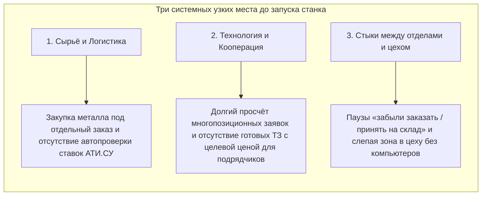

# 🏭 Индустриальная ОС для компании Makota: Архитектура интеграции ИИ в производство
### Варианты внедрения, целевые метрики и базовый запуск за 8 недель для мелкосерийного машиностроения и многопозиционных комплектаций

> **Главный принцип**: Мы не предлагаем компании **Makota** «болтливого чат-бота» или «тяжёлую ERP на полтора года». Мы разворачиваем точное расчётное ядро, ИИ-контролёров и прозрачный диспетчерский пульт поверх вашей 1С, тендерных выгрузок и рабочей среды отделов.  
> **Две главные цели**: **1) Снижение себестоимости обеспечения заказа** (сырьё, логистика, технология, кооперация) и **2) Бесшовная сшивка отделов и цеха** («Цифровой бегунок» без потерь времени между кабинетами).  
> *(Полная версия: [[PRESENTATION|PRESENTATION.md]] • Слайд-дек с инфографикой: `reports/makota_keynote_presentation.html` • Инструкция по работе и настройке: [[01_Дирекция/Инструкция_и_Онбординг_Makota|Инструкция и Онбординг]])*

---

## 🎯 1. Где теряются маржа и скорость на мелкосерийном производстве

При стабильном потоке входящих заявок и тендеров главные потери возникают **на этапе обеспечения заказа и на стыках между отделами**:

1. **Обеспечение заказа (Закупки и Логистика)**: Потребность в металлопрокате из потока тендеров не агрегируется в единые пулы, а заявки на транспорт (АТИ.СУ) требуют независимого автоматического контроля рыночных ставок и догрузов.
2. **Технология и Кооперация («Make-or-Buy»)**: Многопозиционные заявки считаются долго; при передаче заказа внешнему подрядчику («на станки партнёра») у подрядчика уходит много времени на собственный просчёт, из-за чего теряется скорость и проходная цена.
3. **Разрыв между отделами и цехом**: Сотрудники в офисе могут точечно использовать ИИ-инструменты, но между продажами, снабжением, складом и производством нет единой цепочки контроля сроков (SLA), а рабочие в цеху работают по бумажным документам без компьютеров.

---

## 🧩 2. Варианты интеграции ИИ в производство: 3 контура и целевые метрики

Мы предлагаем модульную архитектуру — вы выбираете глубину интеграции под приоритеты бизнеса:

| Контур интеграции | Какие задачи закрывает | Инструменты и механика работы | Целевые метрики и желаемый результат |
|---|---|---|---|
| **Вариант А. Контур «Обеспечение заказа и Себестоимость»** *(Supply & Cost AI)* | Снижение закупочной и логистической себестоимости, рост побед в тендерах по цене. | • **ИИ-контролёр логистики (АТИ.СУ)**: автоматическая сверка заявок логиста с рыночными ставками и попутными догрузами. • **Агрегатор пулов металла**: анализ массива тендеров (выигранных и исторических) для объединения проката в оптовые лоты. • **Make-or-Buy и Пакет для кооперации**: автоформирование готового ТЗ, маршрута и целевой проходной цены для субподрядчика. | • **100% транспортных заявок** проходят автопроверку на переплату до оплаты. • **Сокращение времени расчёта КП** и пакета для подрядчика с дней до минут. • **Снижение себестоимости обеспечения** за счёт консолидации сырья и фильтрации завышенных ставок. |
| **Вариант Б. Контур «Цифровой бегунок и Сшивка отделов»** *(Operations & SLA AI)* | Ликвидация «стен между кабинетами», забытых закупок металла и задержек приёмки на складе. | • **Единая среда компании (MD-карточки / Obsidian + 1С)**: сквозная цепочка `КП → Снабжение → Склад → Цех → ОТК → Отгрузка`. • **SLA-контролёр**: контроль нормативов времени в каждом отделе и ежедневная сводка узких мест руководителю. • **Связь с цехом без компьютеров**: бумажные маршрутные листы со штрихкодом (отметка этапа сканером за 3 секунды). | • **0 «забытых» заказов** на этапе закупки металла или складской приёмки. • **Прозрачность очередей в цеху**: видно, перед каким участком копятся детали. • **Сокращение цикла прохождения заказа** от договора до запуска в работу. |
| **Вариант В. Контур «Инженерный и Цеховой»** *(Shopfloor & Tech AI)* | Ускорение металлообработки, защита от размерного брака и простоев на переналадках. | • **ИИ-справочник технолога**: подбор высокопроизводительного инструмента и режимов съёма. • **Планировщик ЧПУ (EDD)**: расписание очереди станков с учётом матрицы переналадок по сплавам. • **Контроль ресурса пластин и ОТК**: учёт наработки кромок и стабильности размеров ($C_{pk}$). | • **Снижение машинного времени** за счёт перехода на оптимальные стратегии обработки. • **Сокращение потерь на переналадках** при смене марок стали. • **Предупреждение брака** до выхода детали за поле допуска. |

---

## 🚀 3. Что рекомендуем включить в БАЗУ (запуск за 8 недель)

Чтобы получить максимальный финансовый и управленческий эффект без долгой аппаратной интеграции со стойками станков, в **Базовый пакет (8 недель)** мы объединяем самые окупаемые модули из Контуров А и Б:

1. **Единая операционная среда + «Цифровой бегунок» (Order SLA Controller)**:
   - Сшивка отделов (Продажи, Технолог, Снабжение, Склад, Производство) в едином цифровом контуре поверх понятных MD-файлов и выгрузок 1С с автоматическим контролем сроков на каждом этапе.
2. **ИИ-ревизор логистики (АТИ.СУ) и Агрегатор закупок металла (Procurement Pool)**:
   - Подключение к вашей тендерной выгрузке для объединения потребностей в металле и автоматический контроль ставок перевозчиков.
3. **Калькулятор «Make-or-Buy» + Генератор готовых пакетов для кооперации**:
   - Быстрый расчёт маршрутов («точить самим или отдать партнёру») и выпуск готового задания для подрядчика с технологией и целевой проходной ценой.
4. **Базовая оцифровка цеха без компьютеров (Штрихкодирование маршрутных листов)**:
   - Отслеживание движения партий по участкам и выявление узких мест (где копятся детали) без установки планшетов у станков.

> **Что выносится в индивидуальные расширения после Базы (по результатам первых 8 недель):**
> - *Расширение 1*: Прямой Read-Only съём телеметрии со стоек ЧПУ, поминутный контроль износа пластин и авторасписание станков.
> - *Расширение 2*: Кастомный ИИ-агент отдела продаж для квалификации тендеров и проактивной работы по базе заказчиков.
> - *Расширение 3*: Автономный ИИ-скаут мировых практик металлообработки (ежедневные сводки по новому инструменту и технологиям США, Азии и Европы).

---

## 🛡️ 4. Архитектура надёжности и безопасности (Локальный контур)

Система строится по инженерной модели **«8 слоёв корпоративного ИИ»**, где **деньги и технологию считает детерминированное ядро**, а ИИ-ассистент понимает заявки, ищет документы и запускает расчёты (финальное решение всегда утверждает человек):

- **Никаких планшетов и клавиатур у токарей**: на бумажном маршрутном листе печатается крупный штрихкод — один «пик» сканером на старте и один по окончании этапа.
- **Безопасность станков (ISA/IEC 62443)**: система никогда не вмешивается в стойку ЧПУ и G-код. Любой съём данных работает строго в режиме «Только чтение» (Read-Only).
- **100% коммерческая тайна и ролевой доступ**: чертежи, прайсы поставщиков и база клиентов обрабатываются внутри защищённого периметра компании. Директор видит маржу портфеля, снабжение — пулы и прайсы, мастер — очередь участков.

---

## 📅 5. Дорожная карта базового внедрения: 8 недель (4 спринта по 2 недели)

Мы двигаемся короткими 2-недельными спринтами — каждые две недели вы получаете работающий инструмент на реальных данных завода:

1. **Спринт 1 (Недели 1–2) — Аудит данных и единый контур отделов**:
   - Подключение к вашей выгрузке тендеров и архиву заказов. Настройка единой архитектуры карточек заказов (MD / Obsidian + 1С) и регламентов SLA между отделами.
2. **Спринт 2 (Недели 3–4) — «Цифровой бегунок» и ИИ-ревизор закупок/логистики**:
   - Запуск сквозного контроля этапов (`Заявка → Снабжение → Склад → Цех`) с уведомлениями о задержках. Включение контролёра ставок АТИ.СУ и консолидации пулов металлопроката.
3. **Спринт 3 (Недели 5–6) — Калькулятор себестоимости, Make-or-Buy и Кооперация**:
   - Настройка расчёта технологических маршрутов, справочника современного инструмента для технолога и автогенерации готовых пакетов ТЗ с проходной ценой для подрядчиков.
4. **Спринт 4 (Недели 7–8) — Связь с цехом (штрихкоды), обучение и замер KPI**:
   - Запуск маршрутных листов со штрихкодами для отслеживания узких мест в цеху, обучение команды, сдача базового ядра и согласование приоритетных расширений.
