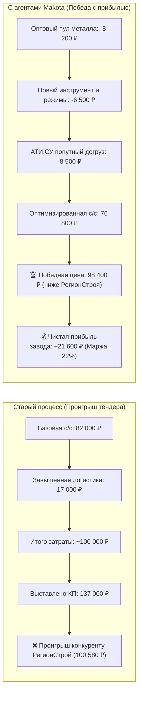
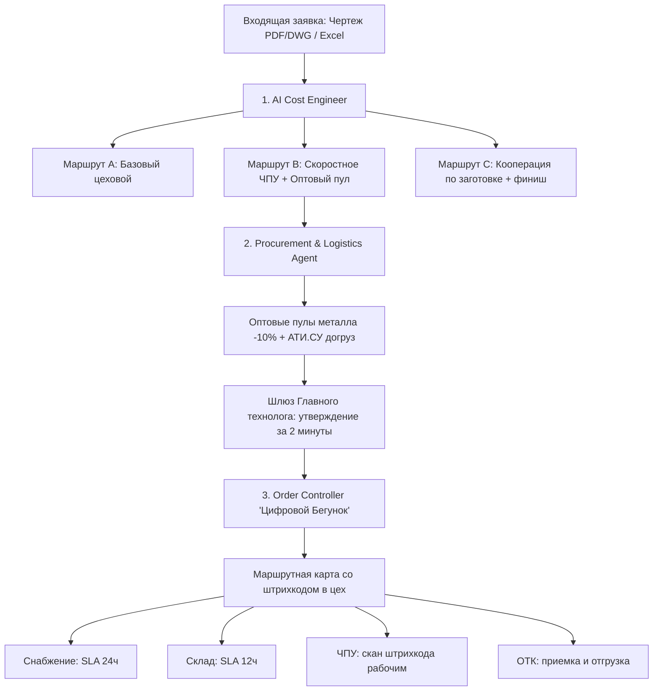

# 🏭 Пилотный демо-презент: Индустриальная ОС Makota
### Как ИИ-агенты устраняют потерю маржи, побеждают в тендерах и ликвидируют задержки между отделами на реальном заводе ЧПУ

> **Главный тезис**: Мы не предлагаем «болтливого чат-бота» или «тяжелую MES на 1.5 года». Мы внедряем легковесный вычислительный контур поверх ваших станков и 1С, который решает **две главные боли завода: снижение себестоимости для победы в заказах и наведение железного порядка в прохождении деталей по цеху.**

---

## 🎯 1. Ответ на вопрос директора: «Почему мы проиграли РегионСтрою?»

На производственном совещании была зафиксирована типичная ситуация:
*«Поступила заявка. Себестоимость посчитали 82 000 ₽ + транспорт 17 000 ₽ = около 100 000 ₽. Выставили заказчику 137 000 ₽. А конкурент "РегионСтрой" забрал сделку за 100 580 ₽. В итоге мы с нулем, станки простаивают, а клиент ушел».*

### За счет чего Makota находит 23 200 ₽ скрытой экономии:
1. **Сырье из Оптового Пула (-8 200 ₽)**: Потребность в прутке объединяется с другими заказами цеха в оптовую закупку от 2.5 тонн со скидкой 10% у металлотрейдера.
2. **Инструмент и режимы резания (-6 500 ₽)**: Вместо высверливания отверстия размером со стакан цельным сверлом в стружку применяется кольцевой рез / корончатая выборка и многопозиционные державки. Машинное время сокращается на 35%.
3. **Контроль логистики через АТИ.СУ (-8 500 ₽)**: Логистический валидатор блокирует необоснованную отдельную Газель за 17 000 ₽ и находит проверенный попутный догруз за 8 500 ₽.

**Результат**: Мы даем заказчику цену **98 400 ₽** (на 2 180 ₽ дешевле РегионСтроя), забираем контракт и зарабатываем **21 600 ₽ чистой прибыли**!

---

## ⚙️ 2. Архитектура решения: 3 специализированных агента

| Агент | Какую проблему решает | Как работает на практике |
|---|---|---|
| **1. AI Cost Engineer** (Расчетчик себестоимости) | Подготовка КП занимала 2–3 дня, считали по устаревшим нормативам, проигрывали торги. | Автоматически считывает размеры и сталь с чертежа, строит **3 альтернативных маршрута** за 15 минут, рассчитывает точную себестоимость и рекомендует победную цену. |
| **2. Procurement & Logistics Agent** (Снабжение и транспорт) | Закупка металла в розницу с наценкой +15%, логисты завышают стоимость перевозок. | Автоматически группирует заявки на ст. 40Х, 12Х18Н10Т, БрАЖ в оптовые пулы от 2.5 т (-10...-14% к цене) и сверяет ставки транспорта с биржей АТИ.СУ. |
| **3. Order Controller** (Цифровой бегунок) | «Заказ приняли, прошло 2 недели, металл забыли купить, цех не знает, где детали». | Контролирует сроки передачи заказа между кабинетами. Если заказ завис дольше норматива — отправляет мгновенный алерт руководству. |

---

## 🛠️ 3. Как это работает в цеху с рабочими без компьютеров

На встрече прозвучало ключевое опасение: *«В офисе понятно, а как это увязать со станками и рабочими, которые работают без компьютеров по бумажкам?»*

**Наш ответ: Никаких планшетов и клавиатур станочникам навязывать не нужно!**
1. Мастер распечатывает привычный **бумажный маршрутный лист**, но вверху напечатан **крупный штрихкод заказа**.
2. Рядом с участком устанавливается простой пылевлагозащищенный сканер штрихкодов (стоимостью 4 000 руб.).
3. Токарь или наладчик, приступая к заказу, делает одно движение: **пикает штрихкод** сканером. В системе автоматически загорается зеленый статус: *«Заказ MKT-084 запущен на Станке ЧПУ 01»*.
4. По завершении смены — второй пик. Всё. Никакого ввода текста, никаких клавиатур в масле.

---

## 🛡️ 4. Промышленная безопасность (ISA/IEC 62443)

* **Изолированный съем данных (Read-Only)**: Подключение к стойкам ЧПУ (NC/Siemens/Fanuc) осуществляется через аппаратный Edge-шлюз **исключительно на чтение телеметрии** (обороты, нагрузка на шпиндель, моточасы).
* **Никакого прямого вмешательства в G-код**: ИИ не может самостоятельно запустить или изменить траекторию резца. Это исключает риск столкновений (crash) и поломки дорогостоящего оборудования.
* **Автономия без интернета**: Вся система может работать в закрытом защищенном локальном контуре завода.

---

## 📅 5. Программа 90-дневного пилота

| Этап | Сроки | Что делаем | Результат этапа |
|---|:---:|---|---|
| **Фаза 1: Диагностика и оцифровка** | Дни 1–15 | Загрузка архива 30–50 выполненных и проигранных заказов. Оцифровка марок сталей и ставок станко-часов. | Откалиброванный калькулятор себестоимости под ваши конкретные станки. |
| **Фаза 2: Слой данных и цех** | Дни 16–30 | Подключение 2 станков ЧПУ (read-only) + запуск терминала штрихкодов на участке заготовок. | Прозрачный трекинг заказов без ручного заполнения журналов. |
| **Фаза 3: Боевой контур расчетов** | Дни 31–60 | Запуск агентов Cost Engineer + Procurement Pool. Расчет всех входящих заявок с выдачей 3-х маршрутов. | Сокращение времени подготовки КП с 2 дней до 20 минут. Первые оптовые закупки металла (-10%). |
| **Фаза 4: Аудит в рублях и фиксация эффекта** | Дни 61–90 | Совместный аудит с финансовой службой: подсчет фактически выигранных тендеров и чистой экономии. | Подтвержденный ROI, переход на абонентское сопровождение. |

---

## 💰 6. Экономика пилота и гарантия окупаемости

* **Стоимость пилота**: **150 000 ₽ / месяц** (полное сопровождение инженера, настройка софта и алгоритмов).
* **Точка окупаемости**: **Со 2-го месяца**.
  - Достаточно выиграть **всего 1 дополнительный заказ** на 300 000 – 400 000 ₽, который раньше ушел конкуренту из-за долгого или завышенного расчета.
  - Достаточно сэкономить **8–10% на 2–3 закупках металлопроката** через оптовый пул (например, закупка 5 тонн круга 40Х дает прямую экономию ~50 000 ₽).
* **Суммарный экономический эффект за 90 дней**: **от 450 000 до 1 200 000 ₽** дополнительной маржи.

---

## 🚀 Следующий шаг
1. Предоставить архив 5–10 недавних чертежей (включая заказ, проигранный РегионСтрою).
2. За 48 часов мы прогоним их через вычислительное ядро Makota и покажем сравнительную таблицу: **«Ваш расчет vs Расчет Makota vs Цена конкурента»**.
3. Утвердить запуск Фазы 1 пилота.
