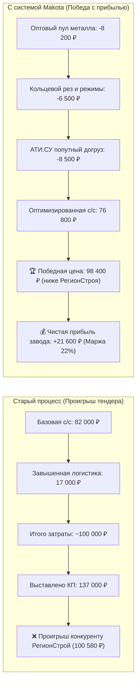

# 🏭 Презентация проекта: Индустриальная ОС Makota
### Как устранить потерю маржи, выигрывать тендеры по цене и навести железный порядок в прохождении заказов между отделами

> **Главный принцип**: Мы не предлагаем «болтливого чат-бота» или «тяжёлую ERP на полтора года». Мы разворачиваем точное математическое ядро и прозрачный диспетчерский пульт поверх ваших станков и 1С, которые решают **две главные задачи завода: снижение себестоимости обеспечения заказа и ликвидацию задержек между кабинетами.**  
> *(Полная версия презентации в корне репозитория: [[PRESENTATION|PRESENTATION.md]] • Инструкция по работе и настройке: [[01_Дирекция/Инструкция_и_Онбординг_Makota|Инструкция и Онбординг]])*

---

## 🎯 1. Ответ на вопрос собственника: «Почему мы проиграли тендер РегионСтрою?»

На производственном совещании была разобрана показательная ситуация:
*«Пришла заявка. Себестоимость посчитали 82 000 ₽ + транспорт 17 000 ₽ = около 100 000 ₽. Выставили заказчику 137 000 ₽. А конкурент "РегионСтрой" забрал заказ за 100 580 ₽. В итоге мы без заказа, станки простаивают, клиент ушёл».*

### За счёт чего Makota находит 23 200 ₽ скрытого резерва на одном заказе:
1. **Сырьё из оптового пула (-8 200 ₽)**: Потребность в круге 150 мм ст. 40Х автоматически объединяется с другими заказами в оптовый лот от 2.5 тонн со скидкой 10% у металлотрейдера.
2. **Оптимальный техмаршрут и режимы (-6 500 ₽)**: Вместо высверливания центрального отверстия сплошным сверлом в стружку применяется кольцевая выборка и режимы пластин GC4325 — машинное время снижается в 2 раза.
3. **Проверка логистики по АТИ.СУ (-8 500 ₽)**: Валидатор блокирует отдельную машину за 17 000 ₽ и рекомендует проверенный попутный догруз за 8 500 ₽.

---

## ⚙️ 2. Все 6 модулей системы (готовы к демонстрации и внедрению)

| Модуль | Какую проблему закрывает | Как работает на практике |
|---|---|---|
| **1. AI Cost Engineer & Make-or-Buy** (`engine/cost_calculator.py`) | Расчёт КП занимал 2–3 дня, проигрывали торги по цене. | Строит **3 альтернативных маршрута** за 15 минут, рассчитывает победную цену для тендера и **точку безразличия ($N^*$)**: какую партию точить самим, а какую отдать на кооперацию. |
| **2. Procurement Pool** (`engine/procurement_matcher.py`) | Покупка металла в розницу под каждый заказ с переплатой 10–15%. | Автоматически группирует потребности в стали (40Х, 12Х18Н10Т, 09Г2С, БрАЖ) в рамках временного окна в оптовые лоты со скидкой до 14%. |
| **3. Logistics Validator** (`engine/logistics_validator.py`) | Завышенные счета на доставку металла и заготовок. | Сверяет ставки перевозчиков с рыночными коридорами АТИ.СУ (отдельная машина vs попутный догруз) и показывает сумму переплаты. |
| **4. Order Controller («Цифровой бегунок»)** (`engine/order_sla_tracker.py`) | «Заказ взяли, прошло 2 недели, металл забыли купить». | Контролирует время нахождения заказа в каждом отделе (КП, снабжение, склад, цех, ОТК). При превышении норматива поднимает красный алерт. |
| **5. Production Planner (Расписание ЧПУ)** (`engine/production_planner.py`) | Хаотичная перестановка деталей и потери часов на переналадках. | Выстраивает очередь заказов по срокам сдачи (EDD) с учётом матрицы переналадок при смене марки стали. |
| **6. Quality & Tooling Monitor** (`engine/quality_and_tooling.py`) | Размерный брак из-за износа пластин на чистовых проходах. | Считает выработку каждой пластины в минутах, заранее предупреждает наладчика о замене кромки и проверяет стабильность размеров ($C_{pk}$). |

---

## 🛠️ 3. Работа в цеху без компьютеров и полная безопасность ЧПУ

- **Никаких планшетов и клавиатур у токарей**: на бумажном маршрутном листе печатается крупный штрихкод. Рабочий делает один «пик» сканером на старте и один по окончании смены.
- **Безопасность станков (ISA/IEC 62443)**: система никогда не вмешивается в стойку ЧПУ и G-код. Любой съём телеметрии работает строго в режиме «Только чтение» (Read-Only).
- **100% коммерческая тайна**: все расчёты выполняются локально внутри периметра завода без отправки чертежей и цен во внешние облака.

---

## 📅 4. Дорожная карта внедрения и кастомизации под ваш завод

1. **Шаг 0 (48 часов)**: Бесплатный прогон ваших 5–10 исторических заказов и тендерной выгрузки с расчётом конкретной экономии в рублях.
2. **Фаза 1 (Недели 1–4)**: Настройка под ваши марки сталей, поставщиков и нормативы отделов. Запуск оптовых пулов и «Цифрового бегунка» на живых заказах.
3. **Фаза 2 (Недели 5–8)**: Настройка калькулятора КП под ваши ставки станко-часа, техкарты и интеграция с выгрузками 1С.
4. **Фаза 3 (Недели 9–12)**: Запуск расписания ЧПУ, учёта стойкости инструмента, штрихкодирования маршрутных листов и обучение вашей команды.
