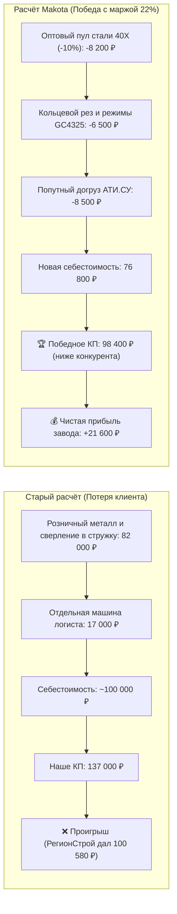

# 🏭 Makota Industrial OS — Презентация проекта для собственника и дирекции производства

> **Кому адресован документ**: Собственнику предприятия, Генеральному директору, Коммерческому директору, Главному инженеру и Главному технологу.  
> **В двух словах**: Makota — это практическая система управления себестоимостью, закупками металла и сроками исполнения заказов для металлообрабатывающего производства. Без ломания привычных процессов, без замены людей и без многолетних внедрений.

---

## 1. В чём реальная проблема производства сегодня

На любом действующем заводе ЧПУ и мехобработки деньги теряются не тогда, когда станок точит деталь, а **до запуска станка и на стыках между кабинетами**:

1. **Проигрыш выгодных заказов по цене или скорости ответа**  
   Когда приходит заявка на 20–100 позиций по чертежам, расчёт КП занимает от одного до трёх дней. Металл закладывается по розничному прайсу «на одну партию», технология считается по консервативным нормам (сплошное высверливание прутка в стружку), а логист закладывает отдельную машину. В итоге цена получается неконкурентной, заказ уходит другим, а станки недозагружены.
2. **Невидимые паузы между отделами («эффект забытого заказа»)**  
   Договор подписали, счёт оплатили — а через две недели выясняется, что металл ещё не заказан, сертификат не проверен или заявка застряла между снабжением и складом. Начальник цеха узнаёт об этом в день, когда нужно начинать обработку, и начинается аврал со штрафами за просрочку.
3. **Скрытый брак и потери станочного времени**  
   Невремя повёрнутая изношенная пластина на расточном резце приводит к уходу посадочного диаметра на 0.03 мм и браку всей подпартии, а хаотичная перестановка заказов с чёрной стали на нержавейку и бронзу съедает часы на лишних переналадках.

---

## 2. Что такое Makota и чем она отличается от «тяжёлых ERP» и «чат-ботов»

Мы **не предлагаем** «говорящего чат-бота» (языковые модели не умеют надёжно считать деньги и режимы резания — они ошибаются в арифметике) и **не предлагаем** сносить вашу 1С ради внедрения тяжёлой MES-системы на полтора года.

**Makota Industrial OS** — это лёгкий расчётный и диспетчерский надстрой поверх вашей текущей работы, состоящий из двух частей:
- **Точное математическое ядро (`engine/`)**: считает себестоимость в трёх вариантах, объединяет металл в оптовые лоты, сверяет транспорт с рынком АТИ.СУ, вычисляет точку безразличия «своё ЧПУ или субподряд», следит за сроками каждого отдела и строит оптимальную очередь станков.
- **Прозрачный пульт управления (Интерактивный HTML-дашборд + рабочая среда Obsidian)**: понятные карточки заказов, станков, техкарт, поставщиков и отчётов для директора и отделов.

---

## 3. Разбор на живом примере: как превратить проигранный тендер в +21 600 ₽ чистой прибыли

Возьмём реальную ситуацию с производственного совещания (**кейс «РегионСтрой»**, партия переходных фланцев D140 из стали 40Х):
- **Как посчитали по-старому**: себестоимость материала и обработки вышла **82 000 ₽** + доставка отдельной машиной **17 000 ₽** = почти **100 000 ₽** затрат. С учётом наценки клиенту выставили **137 000 ₽**.
- **Что произошло**: конкурент «РегионСтрой» забрал заказ за **100 580 ₽**. Завод остался без заказа.

### Как эту же заявку просчитывает Makota за 15 минут:

| Источник экономии | Что делает система | Эффект в рублях |
|---|---|---:|
| **1. Оптовый пул металла** | Видит, что сталь 40Х (круг 150 мм) нужна ещё по двум заказам, и объединяет закупку в лот 2.85 т со скидкой 10% у трейдера. | **-8 200 ₽** |
| **2. Технологический маршрут B** | Вместо высверливания центра в стружку предлагает кольцевой рез / трубную заготовку и скоростные режимы резания (время падает с 28 до 14 мин). | **-6 500 ₽** |
| **3. Контроль логистики АТИ.СУ** | Блокирует заявку логиста на отдельную машину за 17 000 ₽ для груза 1.2 т и рекомендует попутный догруз (LTL) по рыночной ставке. | **-8 500 ₽** |
| **ИТОГО** | **Снижение себестоимости со 100 000 ₽ до 76 800 ₽** | **23 200 ₽ экономии** |

**Итог для собственника**: Завод даёт клиенту цену **98 400 ₽** (на 2 180 ₽ дешевле «РегионСтроя»), выигрывает тендер, загружает токарный участок и зарабатывает **21 600 ₽ чистой прибыли**.

---

## 4. Шесть готовых модулей системы (всё уже работает в этом репозитории)

В переданном вам демонстрационном пакете полностью реализованы и протестированы все 6 модулей:

| № | Модуль | Какую задачу закрывает для завода | Где посмотреть в проекте |
|:---:|---|---|---|
| **1** | **Калькулятор КП и Make-or-Buy** | Считает 3 маршрута изготовления (базовый, оптимизированный ЧПУ, кооперация), проверяет проходную цену тендера и вычисляет **точку безразличия ($N^*$)**: какую партию выгоднее точить самим, а какую отдать на субподряд при перегрузке станков. | [`engine/cost_calculator.py`](engine/cost_calculator.py) |
| **2** | **Агрегатор закупок металла (Procurement Pool)** | Автоматически складывает потребности разных заказов по маркам стали (40Х, 12Х18Н10Т, 09Г2С, БрАЖ) и диаметрам в рамках временного окна, чтобы покупать металл оптом со скидкой 7–14%. | [`engine/procurement_matcher.py`](engine/procurement_matcher.py) |
| **3** | **Аудитор транспортных ставок (Logistics Validator)** | Сверяет каждую заявку на доставку с рыночными коридорами АТИ.СУ (отдельная машина vs попутный догруз) и мгновенно подсвечивает переплату. | [`engine/logistics_validator.py`](engine/logistics_validator.py) |
| **4** | **«Цифровой бегунок» (Order Controller SLA)** | Следит за нормативами времени на каждом этапе: расчёт КП ($\le 4$ ч), снабжение ($\le 24$ ч), приёмка склада ($\le 12$ ч), цех ($\le 72$ ч), ОТК ($\le 8$ ч). Если заказ завис — формирует красный сигнал директору. | [`engine/order_sla_tracker.py`](engine/order_sla_tracker.py) |
| **5** | **Планировщик очереди ЧПУ (Production Planner)** | Строит расписание станков по срокам отгрузки (EDD) и учитывает матрицу переналадок при переходе со стали на нержавейку или бронзу, предупреждая о риске опоздания. | [`engine/production_planner.py`](engine/production_planner.py) |
| **6** | **Контроль стойкости пластин и ОТК (Quality & Tooling)** | Отслеживает наработку режущих кромок в минутах (предупреждая наладчика до появления брака) и проверяет замеры ОТК с расчётом индекса стабильности $C_{pk}$. | [`engine/quality_and_tooling.py`](engine/quality_and_tooling.py) |

---

## 5. Ответы на три главных вопроса руководства завода

### Вопрос 1: «У нас станочники работают без компьютеров по бумажным чертежам. Они не будут заполнять таблицы!»
**И не нужно.** Мы не ставим в цех хрупкие планшеты и не заставляем токарей печатать руками в СОЖ и масле:
1. Вся работа со статусами на первом этапе идёт на уровне офиса (продажи, технолог, снабжение, склад).
2. Для цеха мастер распечатывает привычный бумажный маршрутный лист, на котором добавлен **крупный штрихкод заказа**.
3. У станка ставится простой промышленный сканер штрихкодов. Взял деталь в работу — один раз «пикнул» штрихкод. Сдал партию в ОТК — второй раз «пикнул». Статус в пульте директора обновляется за секунду.

### Вопрос 2: «Не испортит ли система дорогой станок ЧПУ?»
**Исключено архитектурно (стандарт безопасности ISA/IEC 62443):**
- Система **никогда не управляет станком и не меняет G-код**.
- При подключении телеметрии съём данных идёт строго в режиме **«Только чтение» (Read-Only)** через изолированный шлюз (обороты, нагрузка шпинделя, счётчик деталей). Любое решение по техпроцессу утверждает ваш главный технолог.

### Вопрос 3: «Куда попадают наши чертежи, прайсы поставщиков и база клиентов?»
**Никуда за пределы вашего предприятия:**
- Всё расчётное ядро работает полностью автономно на вашем локальном сервере или компьютере **без интернета и без облачных сервисов**.
- Ваши чертежи, себестоимость, имена заказчиков и цены поставщиков остаются исключительно внутри контура завода. Мы подписываем официальный договор о неразглашении (NDA).

---

## 6. Как пощупать демо-продукт прямо сейчас за 3 минуты

Мы подготовили репозиторий так, чтобы вы могли оценить систему без программистов:

1. **Интерактивный пульт в браузере (без установки программ)**  
   Просто откройте двойным кликом файл [`reports/makota_interactive_dashboard.html`](reports/makota_interactive_dashboard.html) в любом браузере (Chrome, Safari, Яндекс, Edge). Повигайте ползунки размера партии, скидки на металл, проверьте ставку логиста и посмотрите расписание цеха.
2. **Готовый сводный отчёт пилота**  
   Откройте файл [`reports/pilot_report.md`](reports/pilot_report.md) — это пример автоматической ежедневной сводки для собственника по активным заказам, срывам сроков, пулам металла и очереди ЧПУ.
3. **Пошаговая инструкция по всем функциям и настройке**  
   Откройте [`ONBOARDING.md`](ONBOARDING.md) — там простым языком описано, как пользоваться каждой функцией и как заполнить систему данными вашего завода.

---

## 7. Как мы предлагаем внедрить и настроить систему под ваш завод

Мы работаем короткими прозрачными этапами с привязкой к измеримому результату в рублях:

| Этап сотрудничества | Срок | Что делаем | Что получает собственник на выходе |
|---|:---:|---|---|
| **Шаг 0. Бесплатный тестовый разбор на ваших данных** | **2–3 дня** | Вы передаёте выгрузку недавних тендеров (включая проигранные) и 5–10 типовых заказов. Мы прогоняем их через ядро Makota. | Отчёт с конкретными суммами: сколько завод потерял на розничном металле и логистике и какие тендеры можно было забрать с прибылью. |
| **Этап 1. Запуск «Закупки + Цифровой бегунок» (MVP)** | **Недели 1–4** | Настраиваем справочник ваших сталей, ставок станко-часа, поставщиков и SLA отделов. Запускаем контроль по живым заказам и Telegram-уведомления. | Ни один заказ не теряется между отделами; первые сформированные оптовые пулы закупок металла; пульт руководителя в реальном времени. |
| **Этап 2. Внедрение Cost Engineer и планировщика ЧПУ** | **Недели 5–8** | Интегрируем расчёт 3 маршрутов КП с вашей базой техкарт и 1С; настраиваем расписание парка ЧПУ и контроль ресурса инструмента. | Сокращение времени расчёта сложных заявок с 2–3 дней до 15–30 минут; рост доли выигранных тендеров. |
| **Этап 3. Интеграция с цехом и передача под ключ** | **Недели 9–12** | Подключаем штрихкодирование маршрутных карт, Read-Only мониторинг приоритетных станков ЧПУ, обучаем команду и фиксируем экономический эффект. | Полностью настроенная под ваш завод система + обучение сотрудников + регламенты работы. |

---

## 📞 Как запустить настройку и интеграцию под ваше производство

Чтобы перейти от демонстрационной версии к работе на данных вашего завода:
1. Ознакомьтесь с готовым списком минимальных данных для старта в файле [`reports/data_request.md`](reports/data_request.md).
2. Согласуйте 1-дневный визит нашего инженера на производство для знакомства с главным технологом, начальником цеха и отделом снабжения (программа визита уже подготовлена в [`docs/visit/visit-checklist.md`](docs/visit/visit-checklist.md)).
3. Мы подпишем NDA, загрузим ваши первые данные и за 48 часов покажем расчёт реальной экономии на вашей номенклатуре.
