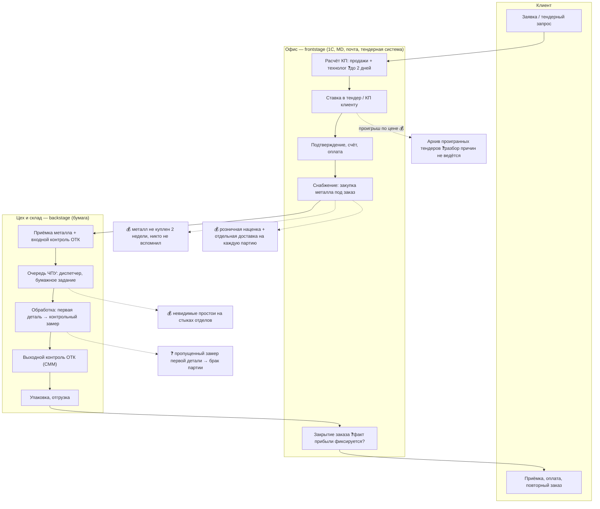

# Service Blueprint: цепочка исполнения заказа Makota (as-is → to-be)

> **Подготовлено**: 2026-11-17 | **Статус**: гипотеза-реконструкция по встрече 11.11 и спекам; **верифицировать на визите** (вопросы — в [`interview-guide.md`](interview-guide.md))
> **Роль**: дизайн-трек пилота (план §8.4). Основа для будущего концепта пульта диспетчера.
> **Легенда**: ❓ — непроверенная гипотеза, заполнить на визите; 💰 — точка потери денег; 🔧 — точка вмешательства MVP.

---

## 1. Карта процесса as-is

**Границы видимости клиента**: клиент видит только КП, счёт и отгрузку. Всё между «оплатил» и «получил» — невидимая зона, где и живут потери (обе задачи владельца — именно про эту зону).

---

## 2. Слои по этапам

| Этап | Актор | Артефакт сегодня ❓ | Информация куда течёт | Типовая потеря 💰 | Вмешательство 🔧 |
|---|---|---|---|---|---|
| Заявка / тендер | Клиент, продажи | Тендерная система (won/lost, марки стали) | В расчёт КП | Проигрыш по цене без разбора причин | **MVP-1**: ретроспектива проигранных — дельта «материал / логистика / маржа» |
| Расчёт КП | Продажи + технолог | Калькуляция ❓шаблон, ставки | Клиенту / на площадку | ❓До 2 дней на расчёт; с/с считается «как привыкли», без альтернатив | Фаза 2 (Cost Engineer): 3 маршрута, калибровка по реальным ставкам |
| Подтверждение, счёт | Продажи | Счёт, договор | Снабжению | ❓КП согласовано, а счёт/заказ металла не запущен | **MVP-2**: SLA «КП → счёт», «оплата → заказ металла» |
| Закупка металла | Снабженец | Заказ поставщику ❓розница, под каждый заказ | Складу, цеху | Розничная наценка; отдельная доставка; «металл 2 недели не куплен» | **MVP-1**: пулы по марке/ГОСТ/диаметру, окно 5 дней, транспортная кратность; закупочный календарь |
| Приёмка + входной контроль | Склад, ОТК | Накладная, сертификат ❓бумага | Цеху | ❓Металл лежит без контроля сутки+; брак в работе | **MVP-2**: SLA «прибыл → контроль» |
| Очередь ЧПУ | Диспетчер, начальник цеха | Бумажное задание, доска ❓ | Станку | Простой узкого места; заказ «забыт» в очереди | **MVP-2**: SLA «сырьё → очередь», журнал потерь |
| Обработка | Наладчик, оператор | Маршрутный лист ❓бумага | ОТК | ❓Первая деталь без замера → брак партии; межоперационные потери | **MVP-2**: SLA «первая деталь → замер ≤30 мин» (гипотеза спеки) |
| Выходной контроль | ОТК | Протокол замеров ❓ | Складу ГП | ❓Готовые детали «теряются» до приёмки | **MVP-2**: SLA «станок → склад ГП» |
| Отгрузка | Логистика | Накладная ❓ | Клиенту | ❓Ставка транспорта выше рынка (отдельная машина vs догруз) | **MVP-1**: валидация ставок по коридорам; сборный груз |
| Закрытие | Владелец / бухгалтерия | ❓Факт прибыли по заказу не считается? | — | Уроки не извлекаются: с/с план/факт не сходится | Фаза 2: факт себестоимости в паспорт заказа (Digital Thread) |

---

## 3. Карта болей (что уже известно, что проверить)

| Боль | Источник | Статус |
|---|---|---|
| Проигрыш тендеров по цене из-за высокой расчётной себестоимости сырья, логистики и обработки | Встреча 11.11, слова владельца | ✅ Факт; декомпозиция дельты на реальной выгрузке — Спринт 1 |
| «Заказ взяли, а металл 2 недели не куплен» | Встреча 11.11 | ✅ Факт (пример); частота и причины — интервью §2.3/2.5 |
| Розничная закупка под каждый заказ + отдельная доставка | Спека Procurement Pool, встреча | 🟡 Гипотеза о масштабе; подтвердить у снабженца |
| Невидимые задержки на стыках отделов | Спека Order Controller | 🟡 Гипотеза; реальные нормативы — таблица SLA гида |
| Расчёт КП до 2 дней | Founder-модель (summary) | ❓ Не верифицировано; замерить у продаж/технолога |
| Факт прибыли по заказу не фиксируется | Реконструкция | ❓ Проверить у владельца/бухгалтерии |

---

## 4. To-be: где именно встают MVP

### MVP-1 «Закупки и тендеры» — до и во время закупки
- **Вход**: тендерная выгрузка + прайсы + история заказов.
- **Точки цепочки ценности**: ретроспектива проигранных тендеров (этап «Ставка») → пулинг потребности (этап «Закупка») → закупочный календарь (сезонность, годовые тендеры на объём) → валидация логистических ставок (этап «Отгрузка»).
- **Выход владельцу**: отчёт с пулами и суммами экономии в ₽, топ проигранных тендеров с разбором. Решение о закупке остаётся за снабженцем/владельцем (HITL).

### MVP-2 «Цифровой бегунок» — поперёк всех стыков
- **Вход**: 3–5 живых заказов, нормативы SLA с визита, контакты ответственных.
- **Механика**: карточки заказов в vault (статусы вводит **офис**, цех не трогаем) → timestamps переходов → Dataview-пульт: просрочка видна в день возникновения → напоминание исполнителю → эскалация руководителю отдела → сводка владельцу. Канал: Telegram/почта (уточнить на визите).
- **Журнал потерь**: каждая эскалация фиксируется с экономическим риском (неустойка, простой) — это доказательная база ценности для коммерческого разговора.

### Границы автоматизации (решения DECISION_LOG 11.14)
- Read-only к учётным системам на старте; черновики и сигналы — на согласование человеку.
- Никаких планшетов рабочим и перестройки цеховых регламентов.
- Итоговое КП подписывает технолог (порог из спеки Cost Engineer — подтвердить на визите).
- Конфиденциальность: локальный контур, обезличивание, NDA.

---

## 5. Моменты истины (moments of truth)

1. **Цена ставки в тендере** — выиграл/проиграл; здесь владелец теряет деньги чаще всего.
2. **Оплата → заказ металла** — первая невидимая стыковка; «2 недели» родились здесь.
3. **Первая деталь → замер** — 30 минут, которые решают судьбу партии.
4. **Обещанный срок отгрузки** — точка, где задержки всех предыдущих этапов становятся видимыми клиенту и превращаются в неустойку.

Пульт диспетчера (будущий дизайн-концепт) должен показывать именно эти четыре момента, а не «всё обо всём».

---

## 6. Открытые вопросы к визиту (закрыть фактами)

- ❓ Реальные времена всех переходов (таблица SLA гида §3) и рабочий календарь смен.
- ❓ Кто и в чём фиксирует факт перехода сегодня (бумага / 1С / слова) — от этого зависит, откуда MVP-2 берёт timestamps без участия цеха.
- ❓ Шаблон калькуляции, ставки станко-часа, коэффициенты отхода, накладные.
- ❓ Практика make-or-buy: критерии, кооператоры, пороги подписи.
- ❓ Ведётся ли факт прибыли по заказу; где живут план/факт себестоимости.
- ❓ Канал алертов, которым реально пользуются ответственные.
- ❓ Годовые тендеры на объём: как закупаются, можно ли пулинг привязать к ним.

## 7. Технический долг, влияющий на blueprint

**Контракт статусов расходится в 4 источниках** (план §6): шаблон vault — вехи M1–M7; JSON-схема — 12 lifecycle-статусов; спека Order Controller — переходы M1–M6 (нумерация M не совпадает с vault!); engine — 7 английских stage-ID. Blueprint намеренно использует названия этапов, а не номера. **До старта MVP-2 нужен единый канонический контракт** (вехи + переходы + маппинг на схему и engine) — иначе пульт SLA и карточки заказов будут показывать разные картины.

## 8. Следующий дизайн-шаг

После верификации blueprint на визите: **концепт пульта диспетчера** (роль пользователя — дизайнер): один экран, четыре момента истины, статусы green/yellow/red/critical, журнал потерь в ₽, сводка владельцу. Входные данные — заполненная таблица SLA и ответы начальника цеха «что бы я хотел видеть на одном экране» (гид §2.5, вопрос 10).
