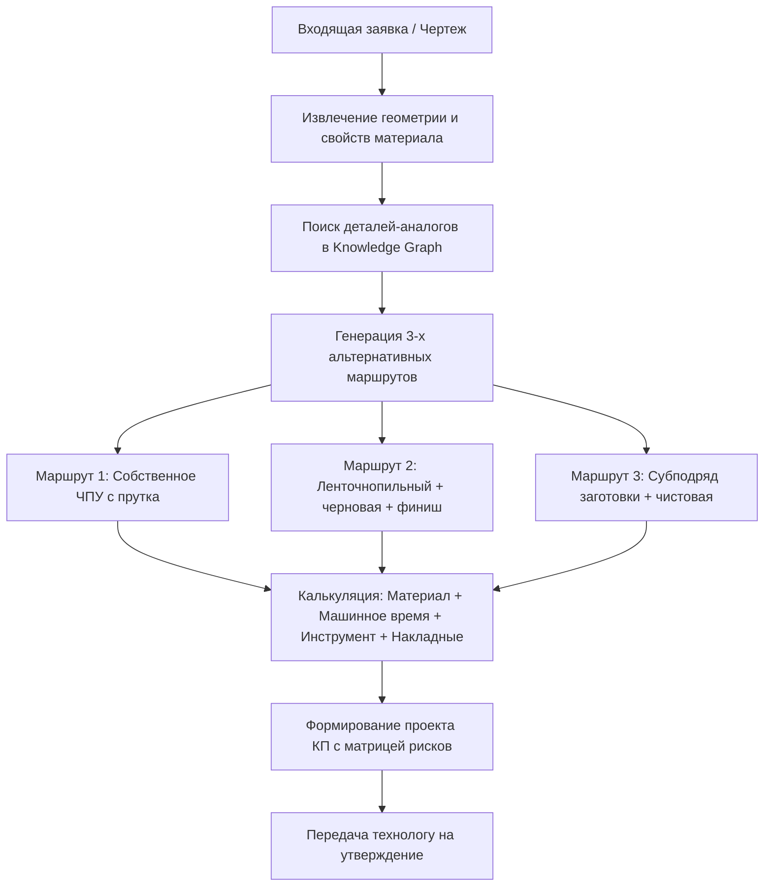

# Спецификация агента: Cost Engineer Agent (AI Cost Engineering)

## 1. Роль и назначение
**Cost Engineer Agent** — специализированный вычислительный и аналитический агент, обеспечивающий мгновенный и точный расчет себестоимости деталей по чертежу или 3D-модели (STEP/PDF/Excel) с генерацией 3 альтернативных технологических маршрутов.

## 2. Входные данные
- Файл чертежа или спецификация (размеры, материал, квалитет точности, шероховатость Ra).
- Текущие биржевые и рыночные цены на металлопрокат (из базы Procurement Agent).
- Стоимость станко-часа по группам оборудования (токарная, фрезерная, шлифовальная).
- Нормативная стойкость и стоимость режущего инструмента.
- База исторических заказов предприятия (для сравнения аналогичных деталей).

## 3. Алгоритм работы

## 4. Формула калькуляции полной себестоимости единицы

$$S_{unit} = C_{mat} \times K_{waste} + \sum_{i=1}^{n} \left( T_{mach\_i} \times R_{mach\_i} + T_{setup\_i} \times \frac{R_{setup\_i}}{N_{batch}} \right) + C_{tool\_wear} + C_{logistics} + S_{overhead}$$

Где:
- $C_{mat}$ — чистый вес детали $\times$ цена за кг сырья.
- $K_{waste}$ — коэффициент отхода в стружку (отношение массы заготовки к массе детали).
- $T_{mach\_i}$ — расчетное машинное время операции $i$.
- $R_{mach\_i}$ — стоимость нормо-часа станка $i$.
- $N_{batch}$ — размер партии (амортизация времени переналадки $T_{setup}$).
- $C_{tool\_wear}$ — удельный износ пластин/фрез на одну деталь.

## 5. Границы автономности (Human-in-the-Loop)
- **Автономно**: первичный расчет, сравнение альтернатив, выявление нетипичных допусков (IT6 и точнее), предупреждение о рисках деформации тонкостенных деталей.
- **Требует подписи технолога**: итоговое КП для клиента, если партия превышает 500 тыс. руб. или деталь содержит класс точности выше 7-го квалитета.

---

## 6. Политика обработки данных (ИБ и On-Prem Контур)

Полная архитектура безопасности описана в [`specs/security/on_prem_llm_architecture.md`](../security/on_prem_llm_architecture.md).

| Входные данные агента | Класс чувствительности | Контур обработки |
|---|---|---|
| ГОСТы материалов, табличные режимы резания | ОТКРЫТЫЕ | База знаний / Локальная или облачная модель |
| Позиции заявки, названия клиентов, прайсы поставщиков | ЧУВСТВИТЕЛЬНЫЕ | Только локальная LLM (`Qwen2.5-7B-Instruct`) |
| Чертежи (STEP/PDF), расчёт себестоимости и маржи | КОНФИДЕНЦИАЛЬНЫЕ | Только детерминированный Python (`engine/cost_calculator.py`) |

---

## 7. Точка безразличия Make-or-Buy ($N^*$) и учёт загрузки парка ЧПУ

Реализовано в `CostEngineer.evaluate_make_or_buy` ([`engine/cost_calculator.py`](../../engine/cost_calculator.py)):

$$N^* = \frac{F_{\text{inhouse}} - F_{\text{sub}}}{V_{\text{sub}} - V_{\text{inhouse}}}$$

Где:
- $F_i = (1 + k_{\text{ovh},i})(C_{\text{setup},i} + C_{\text{logistics},i})$ — постоянные затраты на запуск партии.
- $V_i = (1 + k_{\text{ovh},i})(C_{\text{mat},i} K_{\text{waste},i} + C_{\text{mach},i} + C_{\text{tool},i} + C_{\text{sub},i})$ — переменные затраты на одну деталь.

### Правила принятия решения:
- **`BUY_SUBCONTRACT`**: при $N_{\text{batch}} < N^*$ (малая партия, где переналадка собственного ЧПУ не окупается).
- **`MAKE_IN_HOUSE`**: при $N_{\text{batch}} \ge N^*$ и достаточном фонде свободного станочного времени ($T_{\text{req}} \le T_{\text{avail}}$).
- **`HYBRID_SPLIT`**: при $N_{\text{batch}} \ge N^*$, но дефиците станочного времени ($T_{\text{req}} > T_{\text{avail}}$) — передача черновой операции на кооперацию с финишной доводкой в своём цеху.
