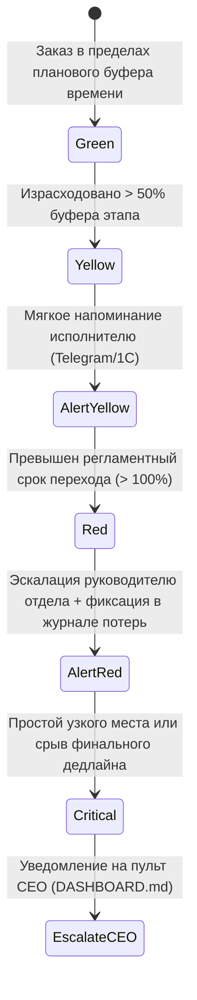

# Спецификация агента: Order Controller («Цифровой бегунок»)

## 1. Роль и назначение
**Order Controller** — автономный агент мониторинга сквозного прохождения заказа по цепочке исполнения (Digital Thread). Его задача — полностью ликвидировать невидимые задержки на стыках отделов («заказ взяли, а металл 2 недели не куплен», «задание на склад отправили, а его сутки не принимают»).

## 2. Карта контрольных точек (Milestones)

| Переход | Контрольный интервал (SLA) | Ответственный | Риск при срыве |
|---|---|---|---|
| **M1: Согласование КП $\to$ Выставление счета** | $\le 2$ рабочих часа | Менеджер по продажам | Клиент уйдет к конкуренту |
| **M2: Оплата счета $\to$ Заказ металла поставщику** | $\le 4$ рабочих часа | Снабженец | Рост цен, потеря наличия на складе |
| **M3: Приемка металла $\to$ Входной контроль ОТК** | $\le 4$ рабочих часа | Кладовщик / ОТК | Запуск бракованного проката в работу |
| **M4: Наличие сырья $\to$ Постановка в очередь ЧПУ** | $\le 8$ рабочих часов | Диспетчер цеха | Простой мощностей, задержка отгрузки |
| **M5: Обработка первой детали $\to$ Контрольный замер** | $\le 30$ минут | Наладчик ЧПУ / Мастер | Риск забраковать всю партию |
| **M6: Выход детали со станка $\to$ Приемка на склад ГП** | $\le 4$ рабочих часа | Логист цеха | Потеря готовых деталей на межоперационке |

## 3. Логика эскалации при отклонениях



## 4. Формат уведомления эскалации

```text
[ORDER CONTROLLER ALERT | КРИТИЧЕСКАЯ ЗАДЕРЖКА]
Заказ: #MKT-2026-084 (Детали фланцевые, 40Х, 200 шт.)
Клиент: ПАО «ТатНефтеМаш»
Текущий этап: Закупка металлопроката (круг 80 мм)
Ответственный: Отдел снабжения (Петров С. И.)
Время простоя: 18 часов (норматив: 4 часа)
Экономический риск: Срыв поставки по договору (неустойка 0.5%/день = 12 500 руб.) + простой токарного участка №2.
Предлагаемое действие: Переключить закупку на альтернативного поставщика со склада в Казани (дельта цены: +3%).
```
