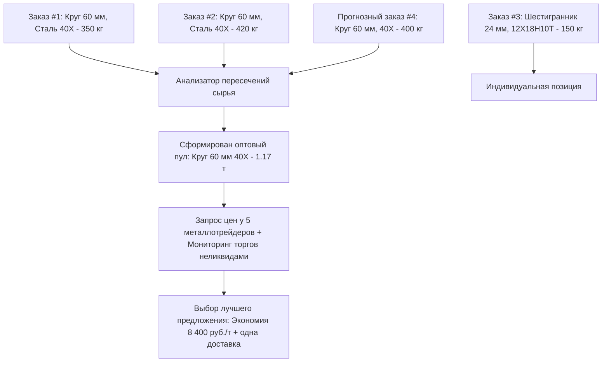

# Спецификация агента: Procurement Pool Agent (Агрегатор закупок сырья)

## 1. Роль и назначение
**Procurement Pool Agent** — агент оптимизации затрат на металлопрокат и материалы. Анализирует входящие спецификации заказов, находит пересечения по профилям, маркам стали и диаметрам и формирует **общие оптовые пулы закупок**, снижая цену за тонну сырья на 7–15%.

## 2. Проблема текущего процесса
На встрече зафиксировано: *«себестоимость около 100 000 руб., конкурент забирает за 100 580»*, при этом заказы рассчитываются и закупаются штучно под конкретный контракт с розничной наценкой металлобазы и отдельной доставкой на каждую партию.

## 3. Алгоритм агрегации пула

## 4. Критерии объединения позиций в пул
1. **Совпадение марки стали и ГОСТ**: Полная идентичность химического состава (например, ст. 40Х по ГОСТ 4543-2016).
2. **Геометрическая совместимость**: Одинаковый диаметр проката либо возможность экономичной проточки смежного диаметра при значительной разнице в цене.
3. **Временное окно консолидации**: Сроки запуска заказов в цех отличаются не более чем на 5 рабочих дней.
4. **Транспортная кратность**: Достижение объема отгрузки, оптимизирующего стоимость грузовой доставки (ГАЗель 1.5 т / Валдай 3.5 т / КамАЗ 10 т).
