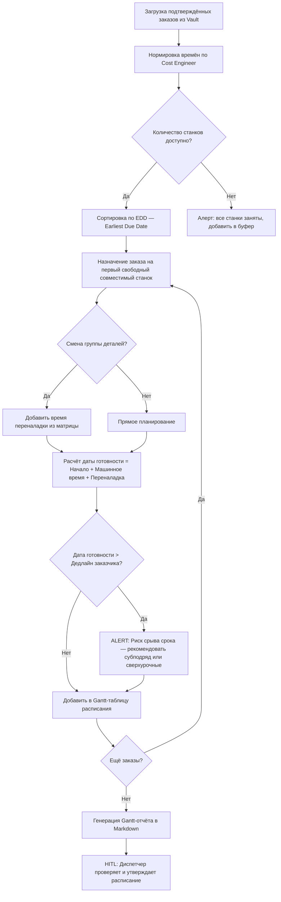

# Спецификация агента: Dynamic Production Scheduler (Алгоритмическое расписание ЧПУ)

## 1. Роль и назначение

**Production Planner Agent** — детерминированный планировщик загрузки парка станков ЧПУ без использования LLM. Задача: автоматически формировать оптимальное расписание обработки деталей по критериям минимизации суммарного опоздания (EDD) и минимизации суммарного времени в очереди (SPT), с учётом переналадок при смене групп деталей.

> **Принцип**: агент вычисляет расписание, диспетчер цеха утверждает его. Прямое управление стойками ЧПУ строго запрещено (ISA/IEC 62443).

---

## 2. Входные данные

| Источник | Данные | Формат |
|---|---|---|
| Obsidian Vault `02_Продажи_и_Заказы/Активные_заказы/` | Заказы со статусом `04_заказ_подтвержден` | YAML frontmatter (order_id, part_name, material, quantity, target_date, estimated_machining_time_min) |
| Vault `03_Производство_и_Технология/Станки_и_Участки/` | Карточки станков | YAML frontmatter (machine_id, machine_type, hourly_rate_rub, current_order, status, oee_percent) |
| `engine/cost_calculator.py` | Нормы машинного времени на операцию | ManufacturingRoute.operations[i].machining_time_min |
| Параметры переналадки | Матрица времён смены групп деталей (материал × профиль) | JSON-конфиг `specs/agents/planner_setup_matrix.json` |

---

## 3. Алгоритм планирования



---

## 4. Формат выходного расписания (Gantt-таблица Markdown)

```markdown
## Расписание цеха на неделю: 2026-11-18 — 2026-11-25

| Станок | Заказ | Деталь | Партия | Начало | Конец | Переналадка | Риск |
|---|---|---|---|---|---|---|---|
| CNC-LATHE-01 | MKT-084 | Фланец D140 (40Х) | 150 шт | 18.11 08:00 | 20.11 17:00 | — | ✅ В срок |
| CNC-LATHE-01 | MKT-086 | Втулка БрАЖ D40 | 200 шт | 20.11 17:30 | 23.11 14:00 | 30 мин | ✅ В срок |
| CNC-5AXIS-02 | MKT-085 | Шайба 12Х18Н10Т | 500 шт | 18.11 08:00 | 19.11 12:00 | — | ✅ В срок |
```

---

## 5. Матрица переналадок (пример конфигурации)

Файл: `specs/agents/planner_setup_matrix.json`

```json
{
  "setup_times_min": {
    "steel_to_bronze": 30,
    "steel_to_stainless": 45,
    "bronze_to_steel": 30,
    "same_material": 10,
    "diameter_change_large": 20
  }
}
```

---

## 6. Границы автономности (Human-in-the-Loop)

| Операция | Режим |
|---|---|
| Расчёт оптимального расписания | **Автономно** |
| Расстановка приоритетов при конфликте дедлайнов | **Автономно** (EDD) |
| Уведомление диспетчера о рисках срыва сроков | **Автономно** |
| Утверждение расписания и запуск в производство | **Только диспетчер** |
| Изменение управляющих программ ЧПУ | **Запрещено** |

---

## 7. Интеграция с другими агентами

- **Cost Engineer** → нормы машинного времени на операцию
- **Order Controller (SLA Tracker)** → получает расписание как плановые SLA этапа `05_shop_floor_cnc`
- **Procurement Pool Agent** → приоритеты обеспечения сырьём синхронизированы с датами запуска расписания
