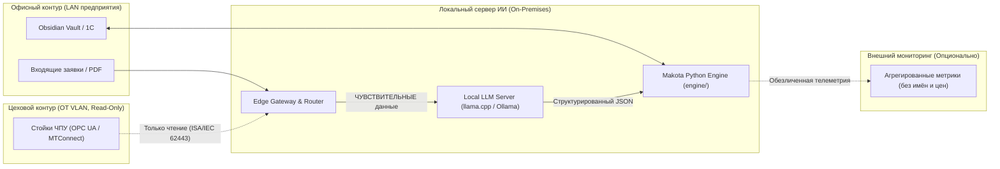

# Архитектура локального ИИ-контура (On-Prem LLM + ИБ)

> **Статус**: Утверждена для пилота | **Дата**: 2026-11-18 | **Стандарт**: ISA/IEC 62443

---

## 1. Контекст и модель угроз

Чертежи деталей (STEP/PDF), прайс-листы поставщиков металлопроката, себестоимость нормо-часа и условия тендеров являются **коммерческой тайной предприятия**. Передача этих данных в публичные облачные LLM API (OpenAI, Anthropic, Google) создаёт три критических риска:
1. Нарушение NDA с заказчиками (особенно в машиностроении и нефтегазовом секторе).
2. Утечка ценовой стратегии и номенклатуры к конкурентам.
3. Прямой запрет служб информационной безопасности заводов на выход коммерческих данных во внешний периметр.

---

## 2. Базовые принципы

- **Zero External Data Egress для чувствительных данных**: файлы чертежей, прайсы и карточки клиентов никогда не покидают локальный контур завода.
- **Изолированный Edge Gateway**: сбор телеметрии со станков ЧПУ (OPC UA / MTConnect) происходит в режиме `Read-Only` через отдельную промышленную VLAN без доступа в интернет.
- **Детерминизм расчётов**: финансовая калькуляция и логика SLA выполняются чистым Python-ядром (`engine/`), а не LLM. Локальная модель используется только для извлечения структуры из неструктурированных заявок (писем, таблиц Excel/PDF).

---

## 3. Архитектурная схема контура

---

## 4. Выбор локальной модели (Inference Stack)

| Параметр | Основной выбор | Альтернатива |
|---|---|---|
| **Модель** | `Qwen2.5-7B-Instruct` (`Q4_K_M`) | `Mistral-7B-Instruct-v0.3` (`Q4_K_M`) |
| **Движок инференса** | `llama.cpp` / `Ollama` (локальный REST API `127.0.0.1:11434`) | `vLLM` (при наличии серверной GPU) |
| **Требования к железу** | 16–32 ГБ RAM (CPU) или 8 ГБ VRAM (RTX 3060/4060) | 16 ГБ VRAM |
| **Обоснование** | Контекст до 32k токенов, высокое качество работы с русскоязычными ГОСТами и таблицами, стабильный JSON-вывод | Хорошая скорость на латинице и STEP-метаданных |

---

## 5. Классификация данных по чувствительности

| Класс | Примеры данных | Разрешённый маршрут обработки |
|---|---|---|
| **ОТКРЫТЫЕ** | Марки стали и ГОСТы (40Х, 12Х18Н10Т), базовые режимы резания из базы знаний, обезличенная документация | Допустимо облако (Cloud LLM) или локальная модель |
| **ЧУВСТВИТЕЛЬНЫЕ** | Имена и контакты клиентов, прайс-листы поставщиков, тендерные заявки, переписка | **Только локальная LLM** в контуре предприятия + Python Engine |
| **КОНФИДЕНЦИАЛЬНЫЕ** | Оригинальные чертежи (STEP/PDF), УП ЧПУ (G-code), калькуляция маржи, данные 1С | **Только детерминированный Python** (`engine/`), без отправки в любые LLM |

---

## 6. Соответствие ISA/IEC 62443 (IT/OT Сегментация)

- **Зональность**: цеховое оборудование (Zone OT) отделено от офисной сети (Zone IT) межсетевым экраном (Conduit) с разрешением только однонаправленного чтения телеметрии (OPC UA Read-Only).
- **Принцип наименьших привилегий**: сервисный аккаунт `makota-edge` имеет доступ только к конкретным папкам выгрузок и базе Obsidian Vault.
- **Аудит доступа**: все запуски `vault_runner.py` и обращения к локальному LLM API логируются с указанием времени и типа операции.

---

## 7. Шаги развёртывания на пилоте

1. Развернуть на мини-ПК / сервере предприятия локальный стек: Python 3.10+ и `Ollama` с загруженной моделью `qwen2.5:7b-instruct-q4_K_M`.
2. Отключить телеметрию и исходящие обновления в конфигурации рантайма.
3. Настроить изолированную рабочую папку для обезличенных выгрузок (чеклист в `reports/data_request.md`).
4. Выполнить тестовый прогон `python3 engine/vault_runner.py` на 3–5 заказах в присутствии ответственного со стороны завода.
