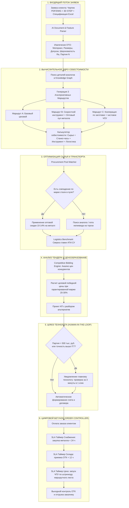

# Спецификация процесса: Оптимальный воркфлоу расчета КП, оптимизации расходов и прохождения заказа (Digital Thread)

> **Стандарт**: ISO 23247 (Digital Twin Manufacturing Framework) / ISA-95  
> **Роли**: Менеджер по продажам, AI Cost Engineer, Главный технолог, Агент снабжения (Procurement Pool), Мастер цеха, Цифровой бегунок (Order Controller).

---

## 1. Концептуальная диаграмма сквозного воркфлоу

---

## 2. Пошаговое описание этапов воркфлоу

### Этап 1. Загрузка и интеллектуальный парсинг ТЗ (Intake & Feature Extraction)
1. **Вход**: Письмо заказчика с чертежами (PDF/DWG/скан), 3D-моделями (STEP) или опросным листом.
2. **Действие ИИ**:
   - Распознавание основной надписи чертежа (штамп): марка материала (например, *Сталь 40Х ГОСТ 4543-2016*), масса заготовки, обозначение.
   - Определение критических требований: квалитеты точности (IT6, IT7), шероховатость ($Ra \le 0.8$), термическая обработка (ТВЧ, улучшение 28...32 HRC), требования к покрытиям (цинкование, оксидирование).
3. **Выход**: Валидированный JSON-паспорт заказа (схема `specs/schemas/digital_thread_order.schema.json`).

### Этап 2. Поиск аналогов и генерация 3 маршрутов (Cost Engineering)
1. Агент сверяется с **Industrial Knowledge Graph**: находились ли в производстве подобные фланцы, втулки, оси или корпуса? Какие были фактические режимы и процент брака?
2. Автоматически формируются 3 альтернативы:
   - **Маршрут А (Базовый)**: стандартная заготовка из прутка, типовой токарный станок 16К20 / стандартный ЧПУ.
   - **Маршрут B (Оптимальный цеховой)**: трубный прокат или предварительный кольцевой рез (сохранение сердцевины от перевода в стружку), высокоподачный инструмент с передовыми пластинами, закупка металла из оптового пула со скидкой 10%.
   - **Маршрут C (Кооперация)**: размещение заготовки у партнера-литьевика / поковщика (например, в Альметьевске или Челнах) + чистовая доводка на своем прецизионном ЧПУ.

### Этап 3. Консолидация пулов сырья и проверка логистики (Procurement & Logistics)
1. Заявка на металл передается в **Procurement Pool Matcher**:
   - Потребность (например, круг 150 мм ст. 40Х, масса 1 650 кг) объединяется с другими активными заказами цеха в единый пул `POOL-40X-150` суммарным весом **2.85 тонны**.
   - Получение оптовой цены трейдера со скидкой **-10%** (-24 500 руб. чистой экономии на сырье).
2. Верификатор логистики **LogisticsValidator**:
   - Сверяет запрошенную логистом цену с рыночным коридором АТИ.СУ.
   - Исключает завышение тарифа (например, замена отдельной машины за 17 000 руб. на проверенный попутный догруз за 8 500 руб.).

### Этап 4. Расчет целевой победной цены в тендере (Competitive Bidding)
1. На основе сниженной себестоимости ИИ рассчитывает вилку цен:
   - *Минимальная безубыточная цена (Floor Price)*: при марже 15%.
   - *Рекомендуемая победная цена (Target Winning Price)*: при марже 22–28%, которая обеспечивает прохождение по цене в тендере за счёт оптимизации пула сырья, логистики и выбора стратегии Make-or-Buy (включая выпуск готового ТЗ с целевой ценой для кооперации).
   - *Премиальная цена за срочность*: при сокращении срока изготовления в 2 раза за счет параллельной обработки.

### Этап 5. Шлюз технолога (Human-in-the-Loop)
1. ИИ **не отправляет КП вслепую**:
   - Если заказ стандартный и сумма $<500$ тыс. руб. — формируется драфт счета и КП для менеджера.
   - Если присутствуют жесткие допуски (IT6, посадки под подшипники) или сумма $>500$ тыс. руб. — главному технологу в рабочий экран падает карточка с уже посчитанными маршрутами.
   - Время согласования технологом: **2–3 минуты** (проверить выбранную пластину и нормо-часы вместо 2 дней ручных расчетов с нуля).

### Этап 6. Цифровой бегунок по цеху (Order Controller & SLA)
1. После подтверждения оплаты запускается жесткий таймер сопровождения:
   - *Снабжение*: металл должен быть законтрактован в течение 24 часов.
   - *Склад*: входной контроль и маркировка в течение 12 часов с момента разгрузки.
   - *Цех*: наряд-заказ генерирует маршрутную карту с крупным штрихкодом. Станочник подносит карту к сканеру на входе и выходе смены — система фиксирует реальное время и OEE без использования клавиатур.
   - *ОТК*: измерение первой детали партии на КИМ или калибрами; фиксация годности.
